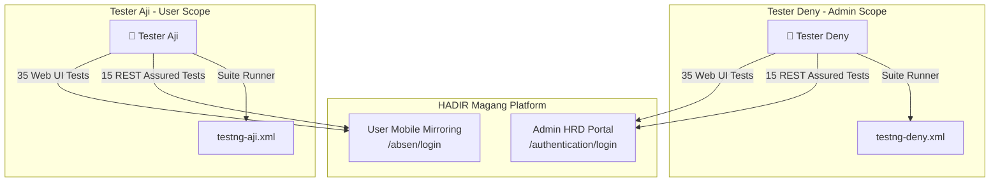

# 🚀 HADIR Magang - Enterprise Web & API Test Automation Framework

[](https://www.oracle.com/java/)
[](https://www.selenium.dev/)
[](https://rest-assured.io/)
[](https://testng.org/)
[](https://www.extentreports.com/)
[](https://maven.apache.org/)

Repositori ini merupakan kerangka kerja otomatisasi pengujian (*enterprise test automation framework*) untuk platform presensi dan manajemen magang **[magang.dikahadir.com](https://magang.dikahadir.com)** (HADIR). 

Framework ini menggabungkan pengujian **Web UI (Selenium WebDriver 4)** dan **Backend API (REST Assured 5)** berbasis **Java 21**, dirancang khusus untuk kolaborasi multi-tester (*Tester Deny* & *Tester Aji*) dengan pembagian tugas yang terisolasi dan bebas konflik (*zero merge conflict*).

---

## 📑 Daftar Isi
- [1. Arsitektur & Teknologi](#1-arsitektur--teknologi)
- [2. Pembagian Peran & Alokasi Tugas Tim](#2-pembagian-peran--alokasi-tugas-tim)
- [3. Panduan Bergabung untuk Rekan Tester (Quickstart)](#3-panduan-bergabung-untuk-rekan-tester-quickstart)
- [4. Git Workflow & Multi-Device Branching SOP](#4-git-workflow--multi-device-branching-sop)
- [5. Panduan Menjalankan Pengujian (Execution Guide)](#5-panduan-menjalankan-pengujian-execution-guide)
- [6. Keamanan Kredensial (Base64 Security)](#6-keamanan-kredensial-base64-security)
- [7. Pelaporan & Bukti Cacat (ExtentReports 5)](#7-pelaporan--bukti-cacat-extentreports-5)
- [8. Struktur Direktori Proyek](#8-struktur-direktori-proyek)

---

## 1. Arsitektur & Teknologi

| Komponen | Spesifikasi & Versi | Keterangan |
| :--- | :--- | :--- |
| **Aplikasi Target (SUT)** | `https://magang.dikahadir.com` | Platform HADIR Magang |
| **Bahasa Pemrograman** | Java 21 LTS | Enforce via `maven-compiler-plugin` 3.13.0 |
| **Web UI Engine** | Selenium WebDriver `4.29.0` | ThreadLocal Driver, Chrome W3C options, default `headless = true` |
| **API Testing Engine** | REST Assured `5.4.0` | BDD Syntax (`given-when-then`), JSON Path, JWT Bearer Token |
| **Test Runner** | TestNG `7.10.2` | Multi-suite runner (`testng.xml`, `testng-deny.xml`, `testng-aji.xml`) |
| **Reporting Dashboard** | ExtentReports `5.1.2` | Dark Theme Spark Reporter, tag kategori per tester, Base64 screenshot |
| **Matriks Pengujian** | Apache POI `5.2.5` | Dokumen SIT 100 Test Cases (`docs/SIT_Scenario_Magang_Hadir.xlsx`) |

---

## 2. Pembagian Peran & Alokasi Tugas Tim

Beban kerja 100 Test Cases dibagi menjadi 2 porsi independen:



| Informasi | 👤 Tester Deny | 👤 Tester Aji |
| :--- | :--- | :--- |
| **Ruang Lingkup** | **ADMIN (Web HRD)** | **USER (Mobile Mirroring)** |
| **Akses URL** | `/authentication/login` | `/absen/login` |
| **Akun Login** | `admin@hadir.com` | `hadirsqa1@gmail.com` |
| **Package Page Objects** | `com.juaracoding.magang.pages.admin.*` | `com.juaracoding.magang.pages.user.*` |
| **Package Tests** | `tests.admin.*` & `api.admin.*` | `tests.user.*` & `api.user.*` |
| **Runner Suite XML** | `src/test/resources/testng-deny.xml` | `src/test/resources/testng-aji.xml` |
| **Git Working Branch** | `feature/tester-deny-admin` | `feature/tester-aji-user` |
| **Total Test Cases** | **50 TCs** (35 UI + 15 API) | **50 TCs** (35 UI + 15 API) |

---

## 3. Panduan Bergabung untuk Rekan Tester (Quickstart)

Bagi rekan tester yang baru bergabung, ikuti langkah berikut di komputer masing-masing:

### Langkah 1: Pastikan Prasyarat Terpasang
1. **Java 21 LTS**:
   ```bash
   java -version
   ```
2. **Apache Maven 3.9+**:
   ```bash
   mvn -version
   ```
3. **Google Chrome**: Versi terbaru.

### Langkah 2: Clone Repositori
```bash
git clone <URL_REPOSITORY_GITHUB_ANDA>
cd magang-automation-framework
```

### Langkah 3: Compile & Unduh Dependensi
```bash
mvn clean test-compile
```
*Jika muncul status `BUILD SUCCESS`, maka seluruh dependensi dan kompilator Java 21 siap digunakan!*

---

## 4. Git Workflow & Multi-Device Branching SOP

Untuk mencegah terjadinya bentrok kode (*merge conflict*) antar tester:

### 👤 Untuk Tester Deny:
```bash
# Buat branch kerja dari main
git checkout main
git pull origin main
git checkout -b feature/tester-deny-admin

# Kerjakan hanya di package:
# - src/main/java/com/juaracoding/magang/pages/admin/
# - src/test/java/com/juaracoding/magang/tests/admin/
# - src/test/java/com/juaracoding/magang/api/admin/

# Commit & Push ke branch sendiri
git add .
git commit -m "feat(admin): implement admin page objects and tests"
git push origin feature/tester-deny-admin
```

### 👤 Untuk Tester Aji:
```bash
# Buat branch kerja dari main
git checkout main
git pull origin main
git checkout -b feature/tester-aji-user

# Kerjakan hanya di package:
# - src/main/java/com/juaracoding/magang/pages/user/
# - src/test/java/com/juaracoding/magang/tests/user/
# - src/test/java/com/juaracoding/magang/api/user/

# Commit & Push ke branch sendiri
git add .
git commit -m "feat(user): implement user mobile page objects and tests"
git push origin feature/tester-aji-user
```

### 🔀 Penggabungan ke `main` (Merge via Pull Request):
Setelah seluruh skenario masing-masing selesai dan lulus pengujian, buat **Pull Request (PR)** ke branch `main`. Karena folder kerja terpisah 100%, Git akan menggabungkan kode secara otomatis tanpa konflik!

---

## 5. Panduan Menjalankan Pengujian (Execution Guide)

### 🔹 Menjalankan Test API Tertentu
```bash
# Jalankan Smoke API Admin (Tester Deny)
mvn test -Dtest=AdminSmokeApiTest

# Jalankan Smoke API User (Tester Aji)
mvn test -Dtest=UserSmokeApiTest
```

### 🔹 Menjalankan Berdasarkan Suite Tester
```bash
# Jalankan seluruh test milik Deny (Admin UI + API)
mvn test -DsuiteXmlFile=src/test/resources/testng-deny.xml

# Jalankan seluruh test milik Aji (User UI + API)
mvn test -DsuiteXmlFile=src/test/resources/testng-aji.xml
```

### 🔹 Menjalankan Test UI dengan Browser Terbuka (Headed / Visual Mode)
Secara default pengujian berjalan di latar belakang (`headless = true`). Untuk melihat browser bergerak secara visual di layar:
```bash
# Buka browser Chrome secara visual saat test berjalan
mvn test -Dheadless=false -DsuiteXmlFile=src/test/resources/testng-deny.xml
```

### 🔹 Menjalankan Seluruh Master Suite (100 Test Cases)
```bash
mvn clean test
```

---

## 6. Keamanan Kredensial (Base64 Security)

> [!IMPORTANT]
> **Tidak ada kata sandi yang disimpan dalam bentuk plaintext di repositori ini!**

Seluruh password sensitif telah di-encode menggunakan Base64 di kelas `Constants.java`:
- Admin Password: `TWFnYW5nU1FBX0pDQDEyMw==`
- User Password: `U1FBQEhhZGlyMTIzNDU=`

Saat pengujian dijalankan, `SecurityUtil.decode()` akan memulihkan password asli langsung di dalam memori JVM secara dinamis sehingga riwayat commit GitHub tetap bersih dan aman.

---

## 7. Pelaporan & Bukti Cacat (ExtentReports 5)

Setelah pengujian selesai dijalankan, buka file:
📂 **`reports/ExtentReport.html`**

Fitur laporan:
- **Tema Gelap (Dark Theme)** yang nyaman di mata.
- **Diagram Lingkaran (Pie Chart)** ringkasan metrik kelulusan test.
- **Filter Kategori**: Filter instan berdasarkan penguji (`Tester Deny` / `Tester Aji`) atau tipe (`REST Assured API` / `Selenium Web UI`).
- **Tangkapan Layar Otomatis (Base64 Evidence)**: Jika terjadi test gagal pada Web UI, screenshot otomatis tertanam langsung ke dalam file HTML.

Matriks lengkap 100 Skenario dapat dilihat di dokumen:
📂 **`docs/SIT_Scenario_Magang_Hadir.xlsx`**

---

## 8. Struktur Direktori Proyek

```
magang-automation-framework/
├── .gitignore                               # Aturan file yang diabaikan Git (target, ide, logs)
├── .gitattributes                           # Penanganan line endings & binary file (.xlsx)
├── .editorconfig                            # Standar indentasi dan encoding editor
├── pom.xml                                  # Konfigurasi dependensi Maven Java 21
├── README.md                                # Panduan onboarding & dokumentasi framework
├── plan.md                                  # Dokumen rencana implementasi arsitektur
├── tasklist.md                              # Roadmap dan status pelaksanaan 7 fase
│
├── docs/
│   └── SIT_Scenario_Magang_Hadir.xlsx       # Matriks 100 Test Cases (5 Sheet terpisah)
│
├── reports/
│   ├── ExtentReport.html                    # Dashboard interaktif laporan pengujian
│   └── screenshots/                         # Folder bukti screenshot
│
├── src/
│   ├── main/java/com/juaracoding/magang/
│   │   ├── drivers/
│   │   │   └── DriverFactory.java           # ThreadLocal WebDriver manager
│   │   ├── pages/
│   │   │   ├── BasePage.java                # Base POM (Explicit wait wrapper)
│   │   │   ├── admin/                       # [Tester Deny] Page Object Model Admin
│   │   │   │   └── AdminLoginPage.java
│   │   │   └── user/                        # [Tester Aji] Page Object Model User
│   │   │       └── UserLoginPage.java
│   │   ├── reports/
│   │   │   ├── ExtentManager.java           # Singleton ExtentReports 5
│   │   │   └── ExtentTestManager.java       # ThreadLocal test logger
│   │   └── utils/
│   │       ├── Constants.java               # URL, endpoints, Base64 passwords
│   │       ├── SecurityUtil.java            # Base64 decoder/encoder
│   │       └── ScreenshotUtil.java          # Screen capture util
│   │
│   └── test/
│       ├── java/com/juaracoding/magang/
│       │   ├── BaseTest.java                # Base UI Test setup & teardown
│       │   ├── listeners/
│       │   │   └── TestListener.java        # TestNG listener & failure screenshot
│       │   ├── api/
│       │   │   ├── BaseApiTest.java         # Base REST Assured engine & auth helper
│       │   │   ├── admin/                   # [Tester Deny] Skenario API Admin
│       │   │   │   └── AdminSmokeApiTest.java
│       │   │   └── user/                    # [Tester Aji] Skenario API User
│       │   │       └── UserSmokeApiTest.java
│       │   └── tests/
│       │       ├── admin/                   # [Tester Deny] Skenario UI Admin
│       │       │   └── AdminSmokeUiTest.java
│       │       └── user/                    # [Tester Aji] Skenario UI User
│       │           └── UserSmokeUiTest.java
│       │
│       └── resources/
│           ├── testng.xml                   # Master Suite (100 TCs)
│           ├── testng-deny.xml              # Suite khusus Tester Deny (Admin)
│           └── testng-aji.xml               # Suite khusus Tester Aji (User)
```

---
*Dibuat untuk JuaraCoding SQA Batch 31 - Kolaborasi Pengujian Otomasi Enterprise.*

