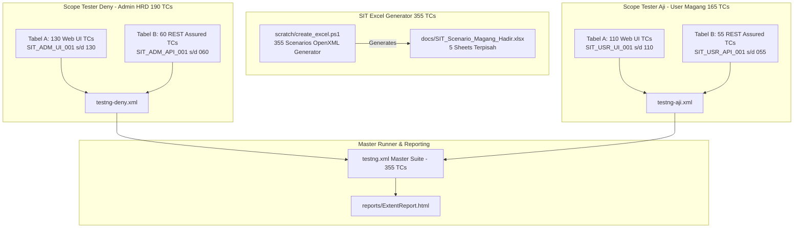
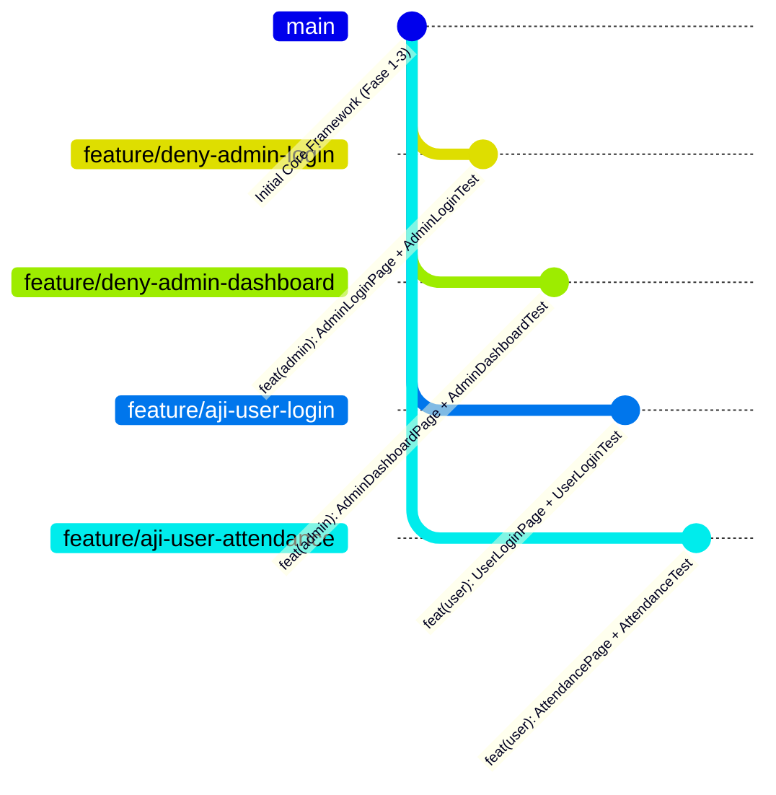

# 📋 Rencana Implementasi: Ekspansi Maksimal 355 Test Cases (240 Web UI & 115 API)

## [Goal Description]
Memperluas cakupan skenario pengujian otomasi tingkat *enterprise* pada platform **[magang.dikahadir.com](https://magang.dikahadir.com)** hingga mencapai **total 355 Test Cases** untuk menggali seluruh fitur, sub-menu, validasi form, edge cases, serta endpoint API secara menyeluruh tanpa dibatasi kuota seimbang:

1. **👤 Tester Deny (Admin HRD Web)**: **Total 190 Test Cases**
   - **130 Skenario Web UI Selenium** (>100 UI TCs): Mencakup Autentikasi Admin (12 TCs), Dashboard & Metrik (10 TCs), 9 Sub-menu Laporan (45 TCs), 4 Sub-menu Import Excel (12 TCs), dan 13 Sub-menu Management Master Data (51 TCs).
   - **60 Skenario REST Assured API** (>50 API TCs): Mencakup Admin Auth & JWT Security (10 TCs), Users Management CRUD (12 TCs), Attendance & Reports API (12 TCs), Approvals Workflow API (10 TCs), dan Master Data CRUD API (16 TCs).

2. **👤 Tester Aji (User Magang Mobile Mirroring)**: **Total 165 Test Cases**
   - **110 Skenario Web UI Selenium** (>100 UI TCs): Mencakup Autentikasi & Sesi Mobile (12 TCs), Self-Registration NIK Excel (12 TCs), Lupa & Reset Password (8 TCs), Presensi Masuk & Keluar Kamera/GPS/WFH/WFO (18 TCs), Aktivitas & Riwayat Presensi (10 TCs), Pengajuan Koreksi Absen (10 TCs), Izin Terlambat & Pulang Cepat (10 TCs), Pengajuan Lembur (10 TCs), Pengajuan Cuti & Klaim Sakit (12 TCs), serta Profil & Ubah Password (8 TCs).
   - **55 Skenario REST Assured API** (>50 API TCs): Mencakup User Auth & Session API (10 TCs), Registration & NIK Check API (8 TCs), Attendance Clock-In/Out API (12 TCs), Activity Log & IDOR Security API (8 TCs), serta Requests Submission API untuk Koreksi, Izin, Cuti, Lembur, Sakit & Profil (17 TCs).

---

## User Review Required

> [!IMPORTANT]
> **Matriks Rekapitulasi 355 Test Cases (Eksplorasi Maksimal)**:
>
> | Parameter Pengujian | 👤 Tester Deny (Admin HRD) | 👤 Tester Aji (User Magang) | Total Keseluruhan |
> | :--- | :---: | :---: | :---: |
> | **Domain Utama SUT** | **ADMIN (Web HRD - 26 Sub-menu)** | **USER (Mobile Mirroring - 10 Modul)** | Seluruh Sistem HADIR |
> | **Akses URL Portal** | `/authentication/login` | `/absen/login` | Web Desktop & Mobile Viewport |
> | **Kredensial Default**| `admin@hadir.com` | `hadirsqa1@gmail.com` | Kredensial Resmi Excel |
> | **Tabel A: Web UI (Selenium)** | **130 Test Cases** (`SIT_ADM_UI_001` - `130`) | **110 Test Cases** (`SIT_USR_UI_001` - `110`) | **240 UI Test Cases** |
> | **Tabel B: API (REST Assured)** | **60 Test Cases** (`SIT_ADM_API_001` - `060`) | **55 Test Cases** (`SIT_USR_API_001` - `055`) | **115 API Test Cases** |
> | **Total per Tester** | **190 Test Cases** | **165 Test Cases** | **355 Test Cases** |

> [!NOTE]
> Di dalam dokumen SIT Excel (`docs/SIT_Scenario_Magang_Hadir.xlsx`), **Tabel A (Web UI)** dan **Tabel B (REST Assured API)** tetap dipisahkan secara tegas di dalam sheet masing-masing tester, ditambah Sheet Master UI (240 TCs) dan Sheet Master API (115 TCs).

---

## Open Questions

> [!TIP]
> Tidak ada pertanyaan yang menghambat. Pembagian jumlah test case kini disesuaikan dengan kepadatan fitur asli aplikasi (Admin memiliki 26 sub-menu tabel & master data sehingga menghasilkan 190 TCs, sedangkan User memiliki 10 modul mobile interaktif yang menghasilkan 165 TCs).

---

## Proposed Changes



---

### 1. Pembaruan Generator & Dokumen Matriks SIT (`docs/SIT_Scenario_Magang_Hadir.xlsx`)

#### [MODIFY] `scratch/create_excel.ps1` & `docs/SIT_Scenario_Magang_Hadir.xlsx`
Memperbarui script generator PowerShell OpenXML untuk menghasilkan **355 Test Cases** yang terdistribusi pada 5 sheet:
- **Sheet 1 (`Summary & Multi-Device Guide`)**: Ringkasan eksekutif 355 TCs (Deny: 130 UI + 60 API = 190 TCs; Aji: 110 UI + 55 API = 165 TCs) beserta panduan kolaborasi Git multi-device.
- **Sheet 2 (`Tester Deny (Admin HRD)`)**:
  - **Tabel A (Web UI Selenium)**: `SIT_ADM_UI_001` s/d `SIT_ADM_UI_130` (130 baris).
  - **Tabel B (REST Assured API)**: `SIT_ADM_API_001` s/d `SIT_ADM_API_060` (60 baris).
- **Sheet 3 (`Tester Aji (User Magang)`)**:
  - **Tabel A (Web UI Selenium)**: `SIT_USR_UI_001` s/d `SIT_USR_UI_110` (110 baris).
  - **Tabel B (REST Assured API)**: `SIT_USR_API_001` s/d `SIT_USR_API_055` (55 baris).
- **Sheet 4 (`Master Matrix - UI Scenarios`)**: Gabungan 240 Skenario Web UI.
- **Sheet 5 (`Master Matrix - API Scenarios`)**: Gabungan 115 Skenario REST Assured API.

---

### 2. Rincian Lengkap 190 Test Cases Tester Deny (Admin Web HRD)

#### Tabel A — 130 Skenario Web UI Admin (`SIT_ADM_UI_001` s/d `SIT_ADM_UI_130`):
| Kategori Modul | Rentang ID | Jumlah | Cakupan Skenario Positif, Negatif & Boundary |
| :--- | :---: | :---: | :--- |
| **1. Autentikasi & Keamanan Sesi Admin** | `001 - 012` | **12 TCs** | Valid login, wrong pass, unregistered email, invalid email format, empty email, empty pass, both empty, show/hide password, SQLi payload, XSS payload, unauthenticated direct URL redirect, logout & session clear. |
| **2. Dashboard Utama & Metrik** | `013 - 022` | **10 TCs** | Metric cards (Total, Hadir, Terlambat, Izin, Cuti, Alpha), filter date range valid, filter Start > End Date (negatif), filter departemen, reset filter, sidebar toggle, chart render, tabel pending approval, pagination (10/25/50), search bar. |
| **3.1. Laporan Semua (`All Report`)** | `023 - 027` | **5 TCs** | Load default data, search nama valid, search nama tidak ada (empty state), filter kombinasi departemen & tanggal, tombol export Excel. |
| **3.2. Laporan Kehadiran (`Attendance`)** | `028 - 032` | **5 TCs** | Tabel kehadiran harian, preview modal foto selfie, klik koordinat Maps, filter Tepat Waktu vs Terlambat, sorting & pagination. |
| **3.3. Laporan Izin Terlambat** | `033 - 037` | **5 TCs** | Tabel izin terlambat, filter status (Pending/Approved/Rejected), Approve izin, Reject izin dengan alasan, Reject tanpa alasan (negatif). |
| **3.4. Laporan Pulang Cepat** | `038 - 042` | **5 TCs** | Tabel pulang cepat, filter tanggal & unit, preview lampiran bukti, Approve pulang cepat, Reject pulang cepat. |
| **3.5. Laporan Cuti (`Leave Report`)** | `043 - 047` | **5 TCs** | Tabel cuti, filter tipe cuti, verifikasi kalkulasi durasi hari cuti, Approve cuti, Reject cuti. |
| **3.6. Laporan Lembur (`Overtime`)** | `048 - 052` | **5 TCs** | Tabel lembur, verifikasi jam mulai-selesai, Approve SPK lembur, Reject SPK lembur, Export laporan lembur. |
| **3.7. Laporan Sakit (`Sick Report`)** | `053 - 057` | **5 TCs** | Tabel klaim sakit, preview Surat Keterangan Dokter (SKD), filter departemen, Approve klaim sakit, Reject dokumen buram/invalid. |
| **3.8. Laporan Koreksi Absen** | `058 - 062` | **5 TCs** | Tabel koreksi absen, komparasi jam asli vs jam koreksi, Approve koreksi, Reject koreksi, filter bulanan. |
| **3.9. Laporan Aktivitas (`Activity`)** | `063 - 067` | **5 TCs** | Tabel log aktivitas peserta, search keyword aktivitas, filter NIK/Nama, filter rentang > 31 hari, export log aktivitas. |
| **4.1. Import Absen** | `068 - 070` | **3 TCs** | Download template Excel, upload `.xlsx` valid, upload ekstensi salah `.pdf/.exe` (negatif). |
| **4.2. Import Struktur User** | `071 - 073` | **3 TCs** | Download template struktur, upload `.xlsx` valid, submit tanpa pilih file (negatif). |
| **4.3. Import Status Aktif** | `074 - 076` | **3 TCs** | Download template status aktif, upload bulk update status, upload file header rusak/kosong (negatif). |
| **4.4. Import Cuti** | `077 - 079` | **3 TCs** | Download template kuota cuti, upload saldo cuti valid, upload nilai kuota negatif (negatif). |
| **5.1. Management User / Karyawan** | `080 - 084` | **5 TCs** | Search by NIK (`D6201031`), tambah user baru valid, tambah NIK/email duplikat (negatif), edit profil user, nonaktifkan user. |
| **5.2. Management Pendaftaran User** | `085 - 088` | **4 TCs** | List whitelist NIK self-regis, tambah NIK baru ke whitelist, edit data calon magang, hapus NIK dari whitelist. |
| **5.3. Management Tipe Pengajuan** | `089 - 092` | **4 TCs** | List tipe pengajuan, tambah tipe baru, tambah dengan nama kosong (negatif), edit & hapus tipe. |
| **5.4. Management Aturan Cuti** | `093 - 096` | **4 TCs** | List aturan cuti, tambah aturan & max hari, input max hari dengan huruf/simbol (negatif), edit & hapus aturan. |
| **5.5. Management Posisi** | `097 - 100` | **4 TCs** | List posisi, tambah posisi baru, tambah posisi duplikat (negatif), edit & hapus posisi. |
| **5.6. Management Departemen** | `101 - 104` | **4 TCs** | List departemen, tambah departemen baru, submit form kosong (negatif), edit & hapus departemen. |
| **5.7. Management Divisi** | `105 - 108` | **4 TCs** | List divisi, tambah divisi & relasi departemen, edit kepala divisi, hapus divisi yang memiliki user aktif (integritas). |
| **5.8. Management Shift Kerja** | `109 - 112` | **4 TCs** | List shift, buat shift baru (`08:00 - 17:00`), jam pulang < jam masuk (negatif), edit toleransi terlambat & hapus shift. |
| **5.9. Management Jadwal Kerja** | `113 - 116` | **4 TCs** | List jadwal kerja, assign shift ke karyawan, assign tanggal kadaluarsa (negatif), ubah jadwal karyawan. |
| **5.10. Management Lokasi / Geofence** | `117 - 120` | **4 TCs** | List lokasi kantor, tambah koordinat Lat/Long & radius, input Latitude di luar `-90..90` (negatif), edit radius & hapus lokasi. |
| **5.11. Management Kalender Libur** | `121 - 124` | **4 TCs** | List hari libur nasional, tambah tanggal libur, tambah tanpa keterangan nama libur (negatif), edit & hapus hari libur. |
| **5.12. Management Level Jabatan** | `125 - 127` | **3 TCs** | List level hirarki jabatan, tambah level jabatan, edit & hapus level jabatan. |
| **5.13. Management Client / Mitra** | `128 - 130` | **3 TCs** | List klien penempatan magang, tambah klien baru beserta alamat & PIC, edit & hapus klien. |

#### Tabel B — 60 Skenario REST Assured API Admin (`SIT_ADM_API_001` s/d `SIT_ADM_API_060`):
- **1. Admin Auth & Token Security API (`001 - 010` — 10 TCs)**:
  Valid login JWT, wrong pass, unregistered email, missing `strategy`, invalid strategy `"oauth2"`, empty JSON `{}`, malformed JSON, wrong HTTP method (`GET /api/login`), JWT payload claims inspection, tampered JWT signature rejection.
- **2. Admin Users Management API (`011 - 022` — 12 TCs)**:
  GET `/api/users` valid token, without token, pagination `$limit=5&$skip=0`, negative `$limit=-1`, filter by email, GET `/api/users/{id}` valid, non-existent ID, POST create user valid, duplicate email conflict, missing mandatory fields, PATCH update user division, DELETE user.
- **3. Admin Attendance & Reports API (`023 - 034` — 12 TCs)**:
  GET `/api/absents` all, filter by `startDate` & `endDate`, filter by `userId`, filter late status, without token, GET `/api/activity` all, pagination `$limit=10`, GET `/api/corrections`, GET `/api/leaves`, GET `/api/overtimes`, SLA response time `< 3000ms`, Content-Type header validation.
- **4. Admin Approvals Workflow API (`035 - 044` — 10 TCs)**:
  PATCH `/api/corrections/{id}` approve, reject with reason, invalid status enum, PATCH `/api/leaves/{id}` approve, reject, invalid ID, PATCH `/api/overtimes/{id}` approve, reject, RBAC test using regular User token (403 Forbidden), without token (401).
- **5. Admin Master Data CRUD API (`045 - 060` — 16 TCs)**:
  Departments (GET, POST valid, POST empty name, PATCH, DELETE), Positions (GET, POST, DELETE), Shifts (GET, POST valid, POST invalid time `"25:99"`), Locations (GET, POST geofence), Holidays (GET, POST, DELETE).

---

### 3. Rincian Lengkap 165 Test Cases Tester Aji (User Magang Mobile Mirroring)

#### Tabel A — 110 Skenario Web UI User (`SIT_USR_UI_001` s/d `SIT_USR_UI_110`):
| Kategori Modul | Rentang ID | Jumlah | Cakupan Skenario Positif, Negatif & Boundary |
| :--- | :---: | :---: | :--- |
| **1. Autentikasi & Sesi Mobile User** | `001 - 012` | **12 TCs** | Valid login (`/absen/login`), wrong pass, unregistered email, invalid email format, empty email, empty pass, both empty, show/hide pass, SQLi, XSS, unauthenticated redirect dari `/apps/absent`, logout & back button check. |
| **2. Self-Registration NIK Excel** | `013 - 024` | **12 TCs** | Navigasi ke Register, cek NIK valid (`F1240001`), auto-fill Nama & Divisi, NIK tidak terdaftar (negatif), NIK sudah teregistrasi (negatif), submit registrasi lengkap dengan foto, format email salah, email duplikat, password terlalu pendek, tanpa upload foto wajah, upload file `.txt/.pdf` pada foto, kembali ke Login. |
| **3. Lupa & Reset Password** | `025 - 032` | **8 TCs** | Navigasi Lupa Password, request email terdaftar, email tidak terdaftar (negatif), email kosong, format email salah, submit password baru cocok, konfirmasi password tidak cocok (negatif), token reset expired (negatif). |
| **4. Presensi Masuk & Keluar (`Clock-In/Out`)** | `033 - 050` | **18 TCs** | Verifikasi beranda (Nama, NIK, Jam Digital, Shift), buka modal kamera Masuk, capture selfie, retake selfie, pilih WFO, pilih WFH, isi catatan Masuk, submit Masuk dalam radius GPS, submit Masuk luar radius tanpa izin (negatif), kamera diblokir (negatif), GPS diblokir (negatif), double Clock-In di hari sama (negatif), perubahan tombol ke Absen Pulang, Clock-Out normal dengan selfie, Clock-Out sebelum jam pulang (peringatan), Clock-Out tanpa selfie (negatif), kartu jam masuk/pulang terupdate, badge status Tepat Waktu/Terlambat. |
| **5. Aktivitas & Riwayat Presensi** | `051 - 060` | **10 TCs** | Navigasi `/apps/absent/activity`, list riwayat bulan berjalan, filter Start & End Date valid, filter Start > End Date (negatif), filter bulan kosong (empty state), klik detail riwayat, tambah log aktivitas harian, tambah aktivitas kosong (negatif), edit aktivitas harian, hapus aktivitas harian. |
| **6. Pengajuan Koreksi Absen** | `061 - 070` | **10 TCs** | Navigasi Koreksi Absen, buka modal form koreksi, submit koreksi masuk & pulang valid, koreksi jam masuk saja, pilih tanggal masa depan/besok (negatif), jam pulang < jam masuk (negatif), alasan kosong (negatif), upload gambar bukti, verifikasi status `Pending`, batalkan pengajuan `Pending`. |
| **7. Pengajuan Izin Terlambat & Pulang Cepat** | `071 - 080` | **10 TCs** | Navigasi menu Izin, submit Izin Terlambat valid, Izin Terlambat tanpa alasan (negatif), submit Izin Pulang Cepat valid, upload foto bukti izin, pilih tanggal backdate bulan lalu (negatif), upload file > 5MB (negatif), filter riwayat status izin, lihat alasan penolakan HRD, batalkan izin `Pending`. |
| **8. Pengajuan Lembur (`Overtime`)** | `081 - 090` | **10 TCs** | Navigasi Lembur, list histori lembur, submit form lembur valid, jam selesai < jam mulai (negatif), durasi 0 menit (negatif), tanpa deskripsi tugas (negatif), upload dokumen SPK lembur, submit lembur duplikat di tanggal/jam sama (negatif), filter bulanan, batalkan lembur `Pending`. |
| **9. Pengajuan Cuti & Klaim Sakit** | `091 - 102` | **12 TCs** | Navigasi Cuti & cek sisa kuota, submit Cuti Tahunan valid, End Date < Start Date (negatif), durasi melebihi sisa kuota (negatif), tanpa delegasi tugas (negatif), tanpa alasan cuti (negatif), navigasi menu Sakit, klaim Sakit 1 hari, klaim Sakit > 2 hari dengan SKD dokter, klaim Sakit > 2 hari tanpa SKD (negatif), upload file `.mp3/.zip` (negatif), histori Cuti & Sakit. |
| **10. Profil Pengguna & Ubah Kata Sandi** | `103 - 110` | **8 TCs** | Navigasi Profil (`/apps/absent/profile`), verifikasi identitas (Nama, NIK `D6201031`, Email, Divisi), ganti foto profil valid, buka form Ubah Password, ubah password dengan password lama benar, password lama salah (negatif), konfirmasi password baru tidak cocok (negatif), password baru sama dengan password lama (negatif). |

#### Tabel B — 55 Skenario REST Assured API User (`SIT_USR_API_001` s/d `SIT_USR_API_055`):
- **1. User Auth & Session API (`001 - 010` — 10 TCs)**:
  POST `/api/login` valid user, wrong pass, invalid email format, empty email, empty pass, suspended user account, POST `/api/forgot-password` valid email, unregistered email, POST `/api/reset-password` invalid token, inspect JWT user claims.
- **2. User Registration & NIK Validation API (`011 - 018` — 8 TCs)**:
  Check valid NIK (`F1240001`), non-existent NIK (`INVALID999`), already registered NIK (`D6201031`), POST `/api/register` valid payload, missing NIK, duplicate email, short password `"123"`, XSS payload in name field.
- **3. User Attendance Clock-In/Out API (`019 - 030` — 12 TCs)**:
  POST `/api/absents` Clock-In valid GPS, Clock-In WFH with notes, without Bearer token, missing lat/long, string lat/long `"abc"`, outside geofence radius, duplicate Clock-In same day, Clock-Out valid, Clock-Out before Clock-In, invalid type `"break"`, GET today's attendance status, SLA response time `< 3000ms`.
- **4. User Activity Log & History API (`031 - 038` — 8 TCs)**:
  GET `/api/activity` user history, filter by `startDate` & `endDate`, without Bearer token, POST `/api/activity` create daily log, empty description (negatif), PATCH `/api/activity/{id}`, DELETE `/api/activity/{id}`, IDOR security check accessing another user's activity.
- **5. User Requests (Corrections, Permits, Leaves, Overtimes, Profile) API (`039 - 055` — 17 TCs)**:
  POST `/api/corrections` valid, empty reason, future date, GET corrections, DELETE pending correction, POST `/api/leaves` late permit, annual leave valid, `endDate < startDate`, exceeding quota, sick claim with attachment, GET leaves history, POST `/api/overtimes` valid, invalid duration, GET overtimes history, GET `/api/users/me` profile, PATCH change password valid, PATCH change password wrong old password.

---

### 4. Sinkronisasi Dokumen Project (`tasklist.md` & `README.md`)

#### [MODIFY] `tasklist.md` & `README.md`
Memperbarui tabel angka cakupan test case pada `tasklist.md` dan `README.md` di kedua direktori kerja (`day31` dan `playwright-testingweb`) menjadi **355 Test Cases** (190 TCs Tester Deny & 165 TCs Tester Aji) tanpa menghapus panduan step-by-step yang sudah ada.

---

## Verification Plan

### Automated Tests
1. **Generate Matriks Excel 355 Test Cases**:
   ```powershell
   powershell -ExecutionPolicy Bypass -File "C:\Users\Asus\.gemini\antigravity\brain\2079e4bb-397e-455b-a6a3-62648ea94f11\scratch\create_excel.ps1"
   ```
2. **Validasi Kompilasi & Smoke Execution**:
   ```powershell
   mvn test-compile
   ```

### Manual Verification
1. Buka file **`docs/SIT_Scenario_Magang_Hadir.xlsx`**:
   - Pastikan **Sheet 2 (`Tester Deny (Admin HRD)`)** memuat **130 baris di Tabel A (UI)** dan **60 baris di Tabel B (API)** = **190 Test Cases**.
   - Pastikan **Sheet 3 (`Tester Aji (User Magang)`)** memuat **110 baris di Tabel A (UI)** dan **55 baris di Tabel B (API)** = **165 Test Cases**.
   - Pastikan **Sheet 4 (`Master Matrix - UI Scenarios`)** memuat **240 Test Cases** dan **Sheet 5 (`Master Matrix - API Scenarios`)** memuat **115 Test Cases**.


---

## 📖 Panduan Praktis Langkah demi Langkah (Step-by-Step Guide) Menjalankan Test UI dan API untuk Tester

Panduan operasional langsung bagi **Tester Deny (Admin HRD - 190 TCs)** dan **Tester Aji (User Magang - 165 TCs)** untuk mengeksekusi pengujian secara mandiri maupun terintegrasi:

### ⚙️ 1. Persiapan Awal Lingkungan (Prerequisites)
Pastikan lingkungan lokal telah terpasang:
1. **Java JDK 21 LTS**: Verifikasi dengan `java -version`.
2. **Apache Maven 3.9+**: Verifikasi dengan `mvn -version`.
3. **Google Chrome**: Versi terbaru (Driver otomatis dikelola oleh Selenium Manager W3C).

---

### 🌐 2. Langkah demi Langkah Pengujian API (REST Assured)

Pengujian API memvalidasi endpoint backend, token JWT, dan respons JSON secara langsung:

#### Langkah 1: Memahami Alur Kredensial & Autentikasi
- Password tersimpan dalam bentuk aman Base64 di kelas `Constants.java`.
- Di runtime, `SecurityUtil.decode()` akan membuka password secara aman langsung di memori untuk dikirim ke endpoint `/api/login`.
- REST Assured akan menangkap `accessToken` (JWT) dan menyematkannya pada header request berikutnya:
  `Authorization: Bearer <token>`

#### Langkah 2: Menjalankan Test API Tertentu
- **Tester Deny (Admin API Test — 60 TCs)**:
  ```powershell
  mvn test -Dtest=AdminSmokeApiTest
  ```
- **Tester Aji (User API Test — 55 TCs)**:
  ```powershell
  mvn test -Dtest=UserSmokeApiTest
  ```

#### Langkah 3: Menjalankan Test API via Runner Suite
- **Tester Deny (Seluruh Scope Admin — 190 TCs)**:
  ```powershell
  mvn test -DsuiteXmlFile=src/test/resources/testng-deny.xml
  ```
- **Tester Aji (Seluruh Scope User — 165 TCs)**:
  ```powershell
  mvn test -DsuiteXmlFile=src/test/resources/testng-aji.xml
  ```

#### Langkah 4: Membaca & Memvalidasi Hasil di Terminal
- Terminal akan menampilkan status eksekusi:
  - `Status Code Response: 200` atau `201` untuk skenario positif.
  - `Status Code Response: 400`, `401`, `422`, atau `500` untuk skenario negatif.
  - Indikator `PASSED` jika semua asersi (`Assert.assertEquals`, `Assert.assertTrue`) terpenuhi.

---

### 🖥️ 3. Langkah demi Langkah Pengujian Web UI (Selenium WebDriver)

Pengujian Web UI mengotomasi interaksi browser Chrome secara end-to-end:

#### Langkah 1: Memilih Mode Eksekusi (Headless vs Visual/Headed)
- **Mode Background (Headless - Default)**:
  ```powershell
  mvn test -DsuiteXmlFile=src/test/resources/testng-deny.xml
  ```
- **Mode Visual / Peragaan Langsung (Headed - Browser Terbuka)**:
  ```powershell
  mvn test -Dheadless=false -DsuiteXmlFile=src/test/resources/testng-deny.xml
  ```

#### Langkah 2: Menjalankan Test UI Tertentu
- **Tester Deny (Admin UI — 130 TCs)**:
  ```powershell
  mvn test -Dtest=AdminSmokeUiTest -Dheadless=false
  ```
- **Tester Aji (User UI Mobile Mirroring — 110 TCs)**:
  ```powershell
  mvn test -Dtest=UserSmokeUiTest -Dheadless=false
  ```

#### Langkah 3: Memantau Alur Uji di Layar
1. Chrome terbuka dan memaksimalkan jendela.
2. Form email dan password terisi secara otomatis tanpa intervensi.
3. Tombol *Login* ditekan secara otomatis.
4. Verifikasi URL dan alert divalidasi oleh sistem.
5. Browser tertutup secara otomatis setelah pengujian selesai.

---

### 📊 4. Langkah demi Langkah Memeriksa Laporan Pengujian

#### Langkah 1: Membuka Dashboard Laporan HTML (ExtentReports 5)
1. Buka file: `reports/ExtentReport.html` di browser Chrome/Edge.
2. Tinjau grafik lingkaran (*Pie Chart*) kelulusan.
3. Gunakan filter kategori: `Tester Deny (Admin HRD)` atau `Tester Aji (User Magang)`.
4. Jika terdapat kegagalan, tinjau bukti screenshot Base64 yang tertanam otomatis.

#### Langkah 2: Memeriksa dan Memperbarui Dokumen SIT Spreadsheet
1. Buka file: `docs/SIT_Scenario_Magang_Hadir.xlsx`.
2. Buka sheet masing-masing penguji (`Tester Deny` atau `Tester Aji`).
3. Periksa status pengujian pada Tabel A (UI) dan Tabel B (API) sesuai hasil eksekusi aktual.


---

## 🌿 Strategi Git Opsi B: Isolated Feature Branching per Modul (Fase 4 & Fase 5)

Sesuai ketetapan **Opsi B**, setiap pembuatan 1 fitur (pasangan **Page Object di Fase 4** + **Test Class di Fase 5**) dikerjakan pada **branch terpisah yang selalu bercabang langsung dari `main`**, dan **tidak di-merge ke `main` secara lokal** agar dapat diajukan melalui **Pull Request (PR)** per fitur di GitHub.



### 📌 Prosedur Eksekusi Git Opsi B (Anti-Conflict):
1. **Selalu Mulai dari `main`**:
   ```powershell
   git checkout main
   git pull origin main
   git checkout -b <nama-branch-fitur>
   ```
2. **Isolasi File di Dalam Branch Fitur**:
   - Hanya buat/edit file Page Object dan Test Class milik fitur tersebut.
   - **Dilarang** mengedit file `BasePage.java`, `BaseTest.java`, `BaseApiTest.java`, `Constants.java`, atau `testng*.xml` di dalam branch fitur agar seluruh 17 branch fitur dapat di-PR ke `main` tanpa *merge conflict*.
3. **Verifikasi Mandiri per Branch**:
   ```powershell
   mvn test -Dtest=<NamaClassTest>
   ```
4. **Commit & Push Branch Fitur ke GitHub**:
   ```powershell
   git add .
   git commit -m "feat(<scope>): implement <NamaPage> and <NamaTest>"
   git push -u origin <nama-branch-fitur>
   git checkout main
   ```

---

## 🤖 Template Prompt Standar untuk AI Agent (Agar Hasil Antar Tester 100% Selaras)

Gunakan template prompt di bawah ini saat memberi instruksi kepada AI Agent di masing-masing komputer/device:

### 1. Prompt AI Agent untuk Tester Deny (Admin HRD — 6 Feature Branches / 190 TCs)
```text
Tolong baca file @plan.md, @tasklist.md, dan @README.md terlebih dahulu sebagai acuan utama.
Saya adalah Tester Deny yang bertanggung jawab pada modul ADMIN (Web HRD) dengan total 190 Test Cases (130 UI + 60 API) sesuai matriks @docs/SIT_Scenario_Magang_Hadir.xlsx.

Kerjakan Fase 4 dan Fase 5 khusus porsi Tester Deny menggunakan aturan ketat Git Opsi B (Isolated Feature Branching tanpa merge ke main):
1. Untuk SETIAP fitur Admin pada tabel "Daftar 6 Branch Fitur — Tester Deny" di @tasklist.md:
   a. Selalu pindah ke branch `main` terlebih dahulu (`git checkout main`), lalu buat branch baru sesuai nama resmi di tasklist (`git checkout -b feature/deny-admin-...`).
   b. Buat class Page Object di package `com.juaracoding.magang.pages.admin` yang mewarisi `BasePage`.
   c. Buat class Test di package `com.juaracoding.magang.tests.admin` (mewarisi `BaseTest`) atau `com.juaracoding.magang.api.admin` (mewarisi `BaseApiTest`).
   d. Gunakan `SecurityUtil.decode(Constants.ADMIN_PASSWORD_ENCODED)` untuk password, dan cantumkan ID Test Case (misal `SIT_ADM_UI_001`) pada `@Test(description = "...")` serta `ExtentTestManager.logInfo(...)`.
   e. JANGAN mengubah file core bersama (`BasePage`, `BaseTest`, `BaseApiTest`, `Constants`, `DriverFactory`, atau `testng*.xml`) agar tidak terjadi merge conflict saat Pull Request.
   f. Jalankan verifikasi `mvn test -Dtest=<NamaClassTest>` hingga kompilasi dan eksekusi berhasil.
   g. Lakukan `git add` dan `git commit` hanya untuk file fitur tersebut di branch fiturnya, JANGAN di-merge ke `main`, lalu kembali ke `git checkout main` sebelum lanjut ke branch fitur berikutnya.
```

### 2. Prompt AI Agent untuk Tester Aji (User Magang — 11 Feature Branches / 165 TCs)
```text
Tolong baca file @plan.md, @tasklist.md, dan @README.md terlebih dahulu sebagai acuan utama.
Saya adalah Tester Aji yang bertanggung jawab pada modul USER (Mobile Mirroring) dengan total 165 Test Cases (110 UI + 55 API) sesuai matriks @docs/SIT_Scenario_Magang_Hadir.xlsx.

Kerjakan Fase 4 dan Fase 5 khusus porsi Tester Aji menggunakan aturan ketat Git Opsi B (Isolated Feature Branching tanpa merge ke main):
1. Untuk SETIAP fitur User pada tabel "Daftar 11 Branch Fitur — Tester Aji" di @tasklist.md:
   a. Selalu pindah ke branch `main` terlebih dahulu (`git checkout main`), lalu buat branch baru sesuai nama resmi di tasklist (`git checkout -b feature/aji-user-...`).
   b. Buat class Page Object di package `com.juaracoding.magang.pages.user` yang mewarisi `BasePage`.
   c. Buat class Test di package `com.juaracoding.magang.tests.user` (mewarisi `BaseTest`) atau `com.juaracoding.magang.api.user` (mewarisi `BaseApiTest`).
   d. Gunakan `SecurityUtil.decode(Constants.USER_PASSWORD_ENCODED)` untuk password, dan cantumkan ID Test Case (misal `SIT_USR_UI_001`) pada `@Test(description = "...")` serta `ExtentTestManager.logInfo(...)`.
   e. JANGAN mengubah file core bersama (`BasePage`, `BaseTest`, `BaseApiTest`, `Constants`, `DriverFactory`, atau `testng*.xml`) agar tidak terjadi merge conflict saat Pull Request.
   f. Jalankan verifikasi `mvn test -Dtest=<NamaClassTest>` hingga kompilasi dan eksekusi berhasil.
   g. Lakukan `git add` dan `git commit` hanya untuk file fitur tersebut di branch fiturnya, JANGAN di-merge ke `main`, lalu kembali ke `git checkout main` sebelum lanjut ke branch fitur berikutnya.
```

### 3. Prompt AI Agent untuk Mengerjakan 1 Fitur Spesifik Saja
```text
Mengacu pada @plan.md dan @tasklist.md (Aturan Git Opsi B), tolong kerjakan HANYA fitur [NAMA_BRANCH_FITUR, contoh: feature/deny-admin-login]:
1. Pastikan checkout dari `main` (`git checkout main && git checkout -b [NAMA_BRANCH_FITUR]`).
2. Implementasikan Page Object dan Test Class sesuai cakupan ID SIT untuk fitur ini tanpa mengubah file core bersama atau testng.xml.
3. Jalankan `mvn test -Dtest=[NAMA_CLASS_TEST]` untuk memvalidasi hasilnya.
4. Commit perubahan di branch `[NAMA_BRANCH_FITUR]` dan jangan di-merge ke `main`.
```
