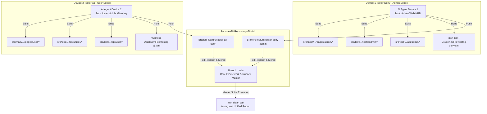
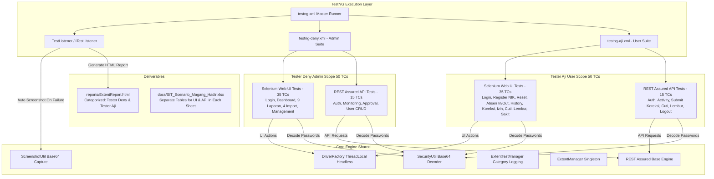

# 📋 Rencana Implementasi: Enterprise Web & API Automation Testing Framework (magang.dikahadir.com)

## [Goal Description]
Membangun kerangka kerja otomatisasi pengujian tingkat *enterprise* yang mencakup **Web UI Automation (Selenium WebDriver 4.29.0)** dan **API Automation (REST Assured 5.4.0)** berbasis **Java 21**, **TestNG 7.10.2**, **ExtentReports 5.1.2**, dan **Apache Maven** dengan target aplikasi **[magang.dikahadir.com](https://magang.dikahadir.com)**.

Pembaruan rencana ini merespons seluruh instruksi terbaru:
1. **Pembalikan Alokasi Peran & Tanggung Jawab**:
   - **👤 Tester Deny**: Menguji seluruh modul **ADMIN (Web HRD)** (Login Admin, Dashboard Metrik, 9 Sub-menu Laporan, 4 Sub-menu Import, 13 Sub-menu Management, serta API Admin).
   - **👤 Tester Aji**: Menguji seluruh modul **USER (Mobile Mirroring)** (Login User, Registrasi NIK Excel, Reset Password, Presensi Masuk/Keluar, Riwayat Aktivitas, Pengajuan Koreksi, Izin, Cuti, Lembur, Sakit, Profil/Ubah Password, serta API User).
2. **Eksplorasi Mendalam & Ekspansi Skenario (100 Test Cases)**:
   - Mencakup seluruh sub-menu dan alur bisnis secara menyeluruh (70 Skenario Web UI Selenium + 30 Skenario REST Assured API).
3. **Pemisahan Jelas Tabel Web UI dan Tabel API**:
   - Di dalam dokumen SIT Spreadsheet (`docs/SIT_Scenario_Magang_Hadir.xlsx`), tabel pengujian Web UI dan tabel pengujian API dipisahkan secara tegas di setiap sheet agar mudah dibaca, diaudit, dan dieksekusi.
4. **Panduan Kolaborasi Multi-Device / Multi-Agent AI**:
   - Dokumentasi arsitektur kerja paralel menggunakan AI Agent di device berbeda tanpa *merge conflict*, sinkronisasi branch Git, eksekusi test runner terpisah, dan integrasi hasil laporan ke ExtentReports & SIT Excel.

---

## User Review Required

> [!IMPORTANT]
> **Matriks Pembagian Peran Baru & Beban Pengujian**:
> 
> | Informasi Pembagian | 👤 Tester Deny (Admin HRD) | 👤 Tester Aji (User Magang) | Total Framework |
> | :--- | :---: | :---: | :---: |
> | **Domain Utama SUT** | **ADMIN (Web HRD)** | **USER (Mobile Mirroring)** | Seluruh Sistem HADIR |
> | **Akses URL** | `/authentication/login` | `/absen/login` | Portal Admin & User |
> | **Kredensial Akun** | `admin@hadir.com` | `hadirsqa1@gmail.com` | Kredensial Resmi Excel |
> | **Password Base64** | `TWFnYW5nU1FBX0pDQDEyMw==` | `U1FBQEhhZGlyMTIzNDU=` | Terenkripsi (Aman GitHub) |
> | **Web UI Test Cases** | **35 Test Cases** (Positif & Negatif) | **35 Test Cases** (Positif & Negatif) | **70 Test Cases** |
> | **REST Assured API** | **15 Test Cases** (Positif & Negatif) | **15 Test Cases** (Positif & Negatif) | **30 Test Cases** |
> | **Total Test Cases** | **50 Test Cases** | **50 Test Cases** | **100 Test Cases** |

---

## 🌐 Panduan Kolaborasi Multi-Device Menggunakan Agent AI di Device Berbeda

Untuk menjalankan pengujian secara paralel di dua komputer/device berbeda dengan AI Agent masing-masing (misal: Device 1 dipegang Deny, Device 2 dipegang Aji) dan tetap menghasilkan kode serta laporan yang selaras saat digabungkan, berikut standar alur kerja (*standard operating procedure*):



### 1. Prinsip Isolasi Package (Mencegah Merge Conflict 100%)
- **Device 1 (Tester Deny)** HANYA membuat dan mengubah file pada package:
  - `com.juaracoding.magang.pages.admin.*`
  - `com.juaracoding.magang.tests.admin.*`
  - `com.juaracoding.magang.api.admin.*`
  - `src/test/resources/testng-deny.xml`
- **Device 2 (Tester Aji)** HANYA membuat dan mengubah file pada package:
  - `com.juaracoding.magang.pages.user.*`
  - `com.juaracoding.magang.tests.user.*`
  - `com.juaracoding.magang.api.user.*`
  - `src/test/resources/testng-aji.xml`
- **File Inti Bersama (Shared Core)**:
  - `DriverFactory`, `BasePage`, `BaseTest`, `BaseApiTest`, `SecurityUtil`, `Constants`, `ExtentManager`, `TestListener` berada di branch `main`. Kedua device cukup menggunakan (*extends / inherits*) kelas-kelas ini tanpa mengubah implementasinya.

### 2. Standar Suite XML Terisolasi
- Di Device 1 (Deny), AI Agent menjalankan:
  ```powershell
  mvn test -DsuiteXmlFile=src/test/resources/testng-deny.xml
  ```
- Di Device 2 (Aji), AI Agent menjalankan:
  ```powershell
  mvn test -DsuiteXmlFile=src/test/resources/testng-aji.xml
  ```
- Ketika kedua branch di-*merge* ke `main`, Master Suite Runner (`testng.xml`) akan mengeksekusi kedua suite secara bersamaan dan menggabungkannya ke dalam satu dashboard ExtentReports terpadu.

### 3. Template Prompt untuk AI Agent di Masing-Masing Device:
> **Prompt untuk AI Agent di Device 1 (Deny)**:
> *"Anda bertindak sebagai SDET untuk Tester Deny. Fokus Anda adalah modul ADMIN (Web HRD) di https://magang.dikahadir.com/authentication/login. Gunakan branch `feature/tester-deny-admin`. Buat Page Object di `pages/admin/`, TestNG classes di `tests/admin/`, dan API tests di `api/admin/`. Gunakan kredensial admin@hadir.com yang didecode dari Constants.ADMIN_PASSWORD_ENCODED. Jalankan test menggunakan `testng-deny.xml`. Jangan mengubah file di package `pages/user/` atau `tests/user/`."*

> **Prompt untuk AI Agent di Device 2 (Aji)**:
> *"Anda bertindak sebagai SDET untuk Tester Aji. Fokus Anda adalah modul USER (Mobile Mirroring) di https://magang.dikahadir.com/absen/login. Gunakan branch `feature/tester-aji-user`. Buat Page Object di `pages/user/`, TestNG classes di `tests/user/`, dan API tests di `api/user/`. Gunakan kredensial hadirsqa1@gmail.com yang didecode dari Constants.USER_PASSWORD_ENCODED. Jalankan test menggunakan `testng-aji.xml`. Jangan mengubah file di package `pages/admin/` atau `tests/admin/`."*

---

## Arsitektur Framework Terintegrasi



---

## Matriks Rinci SIT Test Cases (Total 100 Skenario: 70 UI + 30 API)

Dokumen **`docs/SIT_Scenario_Magang_Hadir.xlsx`** memisahkan tabel pengujian UI dan tabel pengujian API di setiap sheet:

### 👤 Bagian 1: Alokasi Tester Deny — ADMIN (Web HRD)
#### Tabel A: Web UI Automation Scenarios (35 Test Cases)
| TC ID | Sub-Menu / Fitur | Judul Skenario Pengujian UI | Tipe | Prasyarat | Ekspektasi Hasil |
| :--- | :--- | :--- | :---: | :--- | :--- |
| **SIT_ADM_UI_001** | Admin Auth | Login Admin HRD dengan kredensial valid (`admin@hadir.com`) | **Positif** | Akun Admin | Berhasil login, diarahkan ke dashboard `/dashboards/pending`. |
| **SIT_ADM_UI_002** | Admin Auth | Login Admin dengan password salah | **Negatif** | Akun Admin | Muncul alert MUI error *"Akun tidak ditemukan"* / unauthorized. |
| **SIT_ADM_UI_003** | Admin Auth | Login Admin dengan email tidak terdaftar | **Negatif** | Email acak | Muncul alert MUI error kegagalan autentikasi. |
| **SIT_ADM_UI_004** | Admin Auth | Login Admin dengan form email dan password kosong | **Negatif** | Form aktif | Submit form tertahan dengan validasi input wajib. |
| **SIT_ADM_UI_005** | Admin Auth | Logout Admin dan pastikan sesi terhapus | **Positif** | Admin login | Redirect ke `/authentication/login`, URL admin terproteksi kembali. |
| **SIT_ADM_UI_006** | Dashboard HRD | Membuka Dashboard Admin dan validasi widget metrik kehadiran | **Positif** | Admin login | Widget grafik & ringkasan kehadiran/pending tampil lengkap. |
| **SIT_ADM_UI_007** | Dashboard HRD | Navigasi menu sidebar utama (Laporan, Management, Import) | **Positif** | Admin login | Setiap menu merespons dan me-render submenu yang sesuai. |
| **SIT_ADM_UI_008** | Keamanan Route | Akses langsung URL `/dashboards/pending` tanpa session Admin | **Negatif** | Tanpa login | Sistem menolak akses dan me-redirect ke login admin. |
| **SIT_ADM_UI_009** | Laporan Semua | Membuka submenu Laporan Semua dan verifikasi tabel data | **Positif** | Admin login | Tabel menampilkan seluruh aktivitas presensi pegawai. |
| **SIT_ADM_UI_010** | Laporan Kehadiran | Filter data kehadiran berdasarkan Divisi & Rentang Tanggal | **Positif** | Admin login | Tabel memfilter data presensi sesuai parameter divisi. |
| **SIT_ADM_UI_011** | Laporan Kehadiran | Filter data kehadiran dengan rentang tanggal di mana data kosong | **Negatif** | Admin login | Tabel menampilkan status kosong *"Tidak ada data"*. |
| **SIT_ADM_UI_012** | Izin Terlambat | Membuka submenu Laporan Izin Terlambat dan verifikasi list izin | **Positif** | Admin login | List pengajuan izin terlambat tampil dengan statusnya. |
| **SIT_ADM_UI_013** | Izin Pulang Cepat| Membuka submenu Laporan Izin Pulang Cepat dan filter nama pegawai | **Positif** | Admin login | Hasil filter menampilkan data pegawai yang izin pulang cepat. |
| **SIT_ADM_UI_014** | Laporan Cuti | Verifikasi tabel rekapitulasi pengajuan cuti pegawai | **Positif** | Admin login | Tabel menampilkan tipe cuti, durasi tanggal, dan alasan. |
| **SIT_ADM_UI_015** | Approval Cuti | Admin HRD menyetujui (Approve) permohonan cuti pending | **Positif** | Ada pending | Status permohonan cuti menjadi "Approved" & kuota berkurang. |
| **SIT_ADM_UI_016** | Approval Cuti | Admin HRD menolak (Reject) cuti tanpa mengisi catatan alasan | **Negatif** | Ada pending | Sistem mewajibkan alasan penolakan sebelum reject diproses. |
| **SIT_ADM_UI_017** | Laporan Sakit | Membuka submenu Laporan Sakit dan preview surat dokter | **Positif** | Admin login | Modal/popup surat dokter berhasil terbuka untuk diverifikasi. |
| **SIT_ADM_UI_018** | Laporan Lembur | Membuka submenu Laporan Lembur (`/admin/overtimerequest`) | **Positif** | Admin login | Tabel permohonan lembur kerja pegawai tampil lengkap. |
| **SIT_ADM_UI_019** | Approval Lembur | Admin HRD menyetujui (Approve) permohonan lembur kerja | **Positif** | Ada pending | Status lembur disetujui dan waktu lembur terkalkulasi. |
| **SIT_ADM_UI_020** | Approval Lembur | Admin HRD menolak (Reject) permohonan lembur dengan alasan | **Negatif** | Ada pending | Status permohonan lembur berubah menjadi "Rejected". |
| **SIT_ADM_UI_021** | Laporan Koreksi | Membuka submenu Laporan Koreksi Absen (`/monitoring/koreksi`) | **Positif** | Admin login | Daftar pengajuan koreksi jam absensi pegawai tampil. |
| **SIT_ADM_UI_022** | Approval Koreksi | Admin HRD menyetujui pengajuan koreksi jam absen | **Positif** | Ada pending | Data absensi pegawai pada tanggal terkait berhasil diperbarui. |
| **SIT_ADM_UI_023** | Download Absen | Download laporan rekapitulasi kehadiran dalam format file Excel | **Positif** | Admin login | File Excel (.xlsx) berhasil diunduh dengan struktur utuh. |
| **SIT_ADM_UI_024** | Download Absen | Download laporan tanpa memilih tanggal wajib | **Negatif** | Form download | Muncul alert peringatan parameter tanggal belum dipilih. |
| **SIT_ADM_UI_025** | Download Cuti | Download laporan rekapitulasi cuti pegawai ke Excel | **Positif** | Admin login | File Excel laporan cuti ter-download dengan benar. |
| **SIT_ADM_UI_026** | Import Status | Buka halaman Import Status Aktif dan validasi format file template | **Positif** | Admin login | Template Excel import status aktif berhasil diunduh. |
| **SIT_ADM_UI_027** | Import User | Upload file import user dengan format invalid (file .txt) | **Negatif** | Admin login | Sistem menolak upload dan memunculkan error file harus .xlsx. |
| **SIT_ADM_UI_028** | Management User | Pencarian data karyawan berdasarkan NIK valid (`D6201031`) | **Positif** | Admin user | Tabel menampilkan baris data karyawan Hadir SQA Testing 1. |
| **SIT_ADM_UI_029** | Management User | Pencarian data user dengan kata kunci acak yang tidak ada | **Negatif** | Admin user | Tabel menampilkan pesan data user tidak ditemukan. |
| **SIT_ADM_UI_030** | Management User | Toggle status keaktifan user karyawan (Aktif / Non-aktif) | **Positif** | Admin user | Status keaktifan user berhasil diperbarui secara real-time. |
| **SIT_ADM_UI_031** | Pendaftaran User | Buka form pendaftaran user admin (`/management/user-v2/register`) | **Positif** | Admin login | Form registrasi user internal HRD terbuka lengkap. |
| **SIT_ADM_UI_032** | Pendaftaran User | Submit pendaftaran user dengan field NIK dan nama kosong | **Negatif** | Form aktif | Validasi input required muncul mencegah submit form. |
| **SIT_ADM_UI_033** | Management Divisi| Melihat daftar divisi dan memfilter unit kerja | **Positif** | Admin login | Daftar divisi dan unit terkait ter-render dengan rapi. |
| **SIT_ADM_UI_034** | Shifting & Jadwal| Membuka submenu Shifting dan verifikasi jadwal kerja tim | **Positif** | Admin login | Tabel shift pagi/siang/malam dan jam kerja tampil. |
| **SIT_ADM_UI_035** | User Monitoring | Membuka modul User Monitoring (`/management/user-monitoring/add`) | **Positif** | Admin login | Halaman konfigurasi monitoring presensi pegawai terbuka. |

#### Tabel B: REST Assured API Scenarios (15 Test Cases)
| TC ID | Endpoint | Method | Skenario Pengujian API | Tipe | Status Diharapkan |
| :--- | :--- | :---: | :--- | :---: | :---: |
| **SIT_ADM_API_001** | `/api/login` | `POST` | Login Admin dengan kredensial valid (`admin@hadir.com`) | **Positif** | `200 OK` (Token role admin) |
| **SIT_ADM_API_002** | `/api/login` | `POST` | Login Admin dengan password salah | **Negatif** | `401 Unauthorized` |
| **SIT_ADM_API_003** | `/api/login` | `POST` | Login Admin dengan email tidak terdaftar | **Negatif** | `401 Unauthorized` |
| **SIT_ADM_API_004** | `/api/login` | `POST` | Request login tanpa field `strategy` | **Negatif** | `401 Unauthorized` |
| **SIT_ADM_API_005** | `/api/login` | `POST` | Request login dengan empty payload `{}` | **Negatif** | `401 Unauthorized` |
| **SIT_ADM_API_006** | `/api/admin/user` | `GET` | Ambil data list user menggunakan Admin Bearer Token | **Positif** | `200 OK` (Array users) |
| **SIT_ADM_API_007** | `/api/admin/user` | `GET` | Akses endpoint admin/user tanpa Bearer Token | **Negatif** | `401 Unauthorized` |
| **SIT_ADM_API_008** | `/api/admin/user` | `GET` | Akses endpoint admin/user menggunakan Token User biasa | **Negatif** | `403 Forbidden` / `401` |
| **SIT_ADM_API_009** | `/api/activity` | `GET` | Admin mengambil seluruh data presensi semua pegawai | **Positif** | `200 OK` (All records) |
| **SIT_ADM_API_010** | `/api/activity` | `GET` | Admin filter data activity dengan parameter user_id invalid | **Negatif** | `200 OK` / `400` (Empty array) |
| **SIT_ADM_API_011** | `/api/cuti` | `GET` | Ambil antrean pengajuan cuti berstatus pending | **Positif** | `200 OK` (Pending cuti) |
| **SIT_ADM_API_012** | `/api/cuti/{id}` | `PATCH` | Approve pengajuan cuti dengan ID valid via API | **Positif** | `200 OK` (Status updated) |
| **SIT_ADM_API_013** | `/api/cuti/{id}` | `PATCH` | Approve pengajuan cuti dengan ID yang tidak ada | **Negatif** | `404 Not Found` |
| **SIT_ADM_API_014** | `/api/overtime` | `GET` | Ambil data permohonan lembur pegawai via Admin Token | **Positif** | `200 OK` (Array lembur) |
| **SIT_ADM_API_015** | `/api/logout` | `POST` | Logout Admin API dan terminasi token | **Positif** | `200 OK` / `204 No Content` |

---

### 👤 Bagian 2: Alokasi Tester Aji — USER (Mobile Mirroring)
#### Tabel A: Web UI Automation Scenarios (35 Test Cases)
| TC ID | Fitur / Halaman | Judul Skenario Pengujian UI | Tipe | Prasyarat | Ekspektasi Hasil |
| :--- | :--- | :--- | :---: | :--- | :--- |
| **SIT_USR_UI_001** | User Auth | Login Magang dengan kredensial valid (`hadirsqa1@gmail.com`) | **Positif** | User terdaftar | Berhasil login, diarahkan ke dashboard `/apps/absent`. |
| **SIT_USR_UI_002** | User Auth | Login Magang dengan password salah | **Negatif** | User terdaftar | Muncul alert error MUI merah *"Akun tidak ditemukan"*. |
| **SIT_USR_UI_003** | User Auth | Login Magang dengan email belum terdaftar | **Negatif** | Email acak | Muncul alert error *"Akun tidak ditemukan"*. |
| **SIT_USR_UI_004** | User Auth | Login Magang dengan format email invalid (tanpa `@`) | **Negatif** | Form aktif | Validasi HTML5 / UI mencegah submit form. |
| **SIT_USR_UI_005** | User Auth | Login Magang dengan field email dan password kosong | **Negatif** | Form aktif | Submit tertahan, muncul pesan input wajib diisi. |
| **SIT_USR_UI_006** | User Auth | Verifikasi fungsi show/hide toggle password (icon mata) | **Positif** | Form login | Tipe input berganti antara `password` dan `text`. |
| **SIT_USR_UI_007** | Registrasi | Registrasi akun baru dengan NIK valid Excel (`F1240001`) & selfie | **Positif** | NIK tersedia | Form terkirim sukses dan memicu alur pendaftaran. |
| **SIT_USR_UI_008** | Registrasi | Registrasi dengan field form kosong | **Negatif** | Form register | Validasi field wajib muncul, submit form dicegah. |
| **SIT_USR_UI_009** | Registrasi | Registrasi tanpa melampirkan upload foto selfie | **Negatif** | Form terisi | Form menolak pengiriman karena selfie bersifat required. |
| **SIT_USR_UI_010** | Registrasi | Registrasi dengan NIK yang sudah terdaftar (duplikat) | **Negatif** | NIK terdaftar | Muncul alert pesan kegagalan duplikasi data NIK. |
| **SIT_USR_UI_011** | Reset Pass | Permohonan reset password dengan email valid terdaftar | **Positif** | Email terdaftar | Alert sukses hijau muncul konfirmasi link reset terkirim. |
| **SIT_USR_UI_012** | Reset Pass | Permohonan reset password dengan field email kosong | **Negatif** | Form aktif | Validasi input email wajib muncul. |
| **SIT_USR_UI_013** | Reset Pass | Navigasi tombol "Login" kembali dari reset password | **Positif** | Halaman reset | Halaman berpindah kembali ke URL `/absen/login`. |
| **SIT_USR_UI_014** | Presensi Masuk | Presensi Masuk (Check-In) WFO dengan selfie & catatan | **Positif** | User login | Status berubah menjadi "IN", kartu absensi hari ini tampil. |
| **SIT_USR_UI_015** | Presensi Masuk | Presensi Masuk (Check-In) WFH dengan foto & lokasi | **Positif** | User login | Status tercatat "IN (Work From Home)". |
| **SIT_USR_UI_016** | Presensi Masuk | Presensi Masuk tanpa izin akses kamera | **Negatif** | Kamera block | Muncul pesan error izin kamera diperlukan untuk presensi. |
| **SIT_USR_UI_017** | Presensi Keluar | Presensi Pulang (Check-Out) pada hari yang sama | **Positif** | User status IN | Status berubah menjadi "OUT", waktu keluar tercatat. |
| **SIT_USR_UI_018** | Presensi Masuk | Presensi Masuk ganda (Check-in kedua kali di hari yang sama) | **Negatif** | User sudah IN | Sistem menolak check-in ganda / tombol check-in nonaktif. |
| **SIT_USR_UI_019** | Riwayat Absen | Membuka dan melihat list riwayat absensi (`/apps/absent/activity`) | **Positif** | User login | Daftar kartu riwayat absensi tampil dengan badge status. |
| **SIT_USR_UI_020** | Riwayat Absen | Navigasi hyperlink "Selengkapnya" dari dashboard ke activity | **Positif** | Dashboard | URL berpindah tepat ke `/apps/absent/activity`. |
| **SIT_USR_UI_021** | Riwayat Absen | Filter riwayat dengan rentang tanggal tidak valid (Start > End) | **Negatif** | Activity page | Filter menolak atau menampilkan pesan tanggal tidak valid. |
| **SIT_USR_UI_022** | Koreksi Absen | User mengajukan koreksi jam masuk/keluar yang terlewat | **Positif** | User login | Pengajuan koreksi berhasil terkirim ke antrean admin. |
| **SIT_USR_UI_023** | Koreksi Absen | Pengajuan koreksi absen tanpa mengisi alasan koreksi | **Negatif** | Form koreksi | Form menolak pengiriman karena alasan koreksi mandatory. |
| **SIT_USR_UI_024** | Pengajuan Izin | Pengajuan izin terlambat datang dengan alasan jelas | **Positif** | User login | Pengajuan berhasil disimpan dan berstatus "Pending". |
| **SIT_USR_UI_025** | Pengajuan Izin | Pengajuan izin pulang cepat sebelum jam kerja usai | **Positif** | User login | Permohonan izin pulang cepat tersimpan ke sistem. |
| **SIT_USR_UI_026** | Pengajuan Izin | Pengajuan izin tanpa mengisi alasan / keterangan | **Negatif** | Form izin | Validasi form mewajibkan alasan sebelum submit. |
| **SIT_USR_UI_027** | Izin Sakit | Pengajuan izin sakit dengan upload surat dokter (PDF/JPG) | **Positif** | User login | Pengajuan izin sakit tersimpan dengan lampiran bukti. |
| **SIT_USR_UI_028** | Izin Sakit | Pengajuan izin sakit tanpa melampirkan bukti surat dokter | **Negatif** | Form sakit | Sistem menolak submit karena bukti lampiran mandatory. |
| **SIT_USR_UI_029** | Pengajuan Cuti | User mengajukan cuti tahunan dengan tanggal dan alasan valid | **Positif** | Kuota ada | Pengajuan cuti tersimpan dengan status "Pending Approval". |
| **SIT_USR_UI_030** | Pengajuan Cuti | Pengajuan cuti dengan tanggal yang sudah diajukan (bentrok) | **Negatif** | Cuti aktif | Sistem menolak pengajuan karena adanya tanggal tumpang tindih. |
| **SIT_USR_UI_031** | Pengajuan Lembur | User mengajukan lembur kerja dengan jam mulai dan selesai valid | **Positif** | User login | Permohonan lembur tersimpan sukses berstatus pending. |
| **SIT_USR_UI_032** | Pengajuan Lembur | Pengajuan lembur dengan jam mulai lebih besar dari jam selesai | **Negatif** | Form lembur | Validasi error muncul: jam mulai harus lebih awal dari selesai. |
| **SIT_USR_UI_033** | Download Report | Download rekapitulasi absensi personal karyawan | **Positif** | User login | File laporan absensi personal berhasil di-download. |
| **SIT_USR_UI_034** | Ubah Password | User membuka halaman Ubah Password (`/apps/absent/change-password`) | **Positif** | User login | Form ganti password lama dan password baru terbuka. |
| **SIT_USR_UI_035** | Ubah Password | Ubah password dengan konfirmasi password baru tidak cocok | **Negatif** | Form password | Muncul pesan error konfirmasi password tidak sesuai. |

#### Tabel B: REST Assured API Scenarios (15 Test Cases)
| TC ID | Endpoint | Method | Skenario Pengujian API | Tipe | Status Diharapkan |
| :--- | :--- | :---: | :--- | :---: | :---: |
| **SIT_USR_API_001** | `/api/login` | `POST` | Login User Magang kredensial valid via REST Assured | **Positif** | `200 OK` (Access token user) |
| **SIT_USR_API_002** | `/api/login` | `POST` | Login User dengan password salah | **Negatif** | `401 Unauthorized` |
| **SIT_USR_API_003** | `/api/login` | `POST` | Login User dengan email tidak terdaftar | **Negatif** | `401 Unauthorized` |
| **SIT_USR_API_004** | `/api/login` | `POST` | Login User tanpa payload `strategy` | **Negatif** | `401 Unauthorized` |
| **SIT_USR_API_005** | `/api/login` | `POST` | Login User dengan empty JSON payload `{}` | **Negatif** | `401 Unauthorized` |
| **SIT_USR_API_006** | `/api/activity` | `GET` | Ambil riwayat presensi user dengan User Bearer Token | **Positif** | `200 OK` (Array user activity) |
| **SIT_USR_API_007** | `/api/activity` | `GET` | Akses riwayat presensi tanpa menyertakan Header Authorization | **Negatif** | `401 Unauthorized` |
| **SIT_USR_API_008** | `/api/activity` | `GET` | Filter riwayat presensi dengan status `IN` | **Positif** | `200 OK` (Filtered items) |
| **SIT_USR_API_009** | `/api/koreksi` | `POST` | Kirim pengajuan koreksi absen via API dengan body valid | **Positif** | `201 Created` / `200 OK` |
| **SIT_USR_API_010** | `/api/koreksi` | `POST` | Kirim pengajuan koreksi absen tanpa parameter alasan | **Negatif** | `400 Bad Request` |
| **SIT_USR_API_011** | `/api/cuti` | `POST` | Kirim permohonan cuti tahunan via User Bearer Token | **Positif** | `201 Created` / `200 OK` |
| **SIT_USR_API_012** | `/api/cuti` | `POST` | Kirim permohonan cuti tanpa rentang tanggal | **Negatif** | `400 Bad Request` |
| **SIT_USR_API_013** | `/api/overtime` | `POST` | Kirim permohonan lembur dengan jam valid via API | **Positif** | `201 Created` / `200 OK` |
| **SIT_USR_API_014** | `/api/overtime` | `POST` | Kirim permohonan lembur tanpa jam selesai | **Negatif** | `400 Bad Request` |
| **SIT_USR_API_015** | `/api/logout` | `POST` | Logout User API dan menghapus session token | **Positif** | `200 OK` / `204 No Content` |

---

## Struktur Direktori Proyek Terpadu

```
day31/ (dan c:\Projects\JuaraCoding\sqa-batch-31\playwright-testingweb\)
│
├── pom.xml                                  # Dependencies: Selenium 4.29.0, REST Assured 5.4.0, TestNG 7.10.2, ExtentReports 5.1.2, POI 5.2.5
├── plan.md                                  # Dokumen rencana implementasi proyek & panduan multi-device
├── tasklist.md                              # Roadmap dan checklist 7 fase pengujian (Deny & Aji)
├── reference.md                             # Dokumentasi acuan arsitektur enterprise
├── Project SQA Batch 31.xlsx                # File referensi kredensial & modul sistem
│
├── docs/                                    # Dokumentasi pengujian & SIT Matrix
│   └── SIT_Scenario_Magang_Hadir.xlsx       # Multi-sheet (Summary, Deny Admin [UI & API], Aji User [UI & API], Master UI, Master API)
│
├── reports/                                 # Laporan eksekusi otomatis
│   ├── ExtentReport.html                    # Dashboard interaktif ExtentReports 5 (Dark Theme, UI & API)
│   └── screenshots/                         # Direktori screenshot kegagalan Base64 & PNG
│
├── src/
│   ├── main/
│   │   └── java/
│   │       └── com/juaracoding/magang/
│   │           ├── drivers/
│   │           │   └── DriverFactory.java   # ThreadLocal multi-browser (Chrome default headless=true)
│   │           │
│   │           ├── pages/                   # Lapisan Page Object Model (POM)
│   │           │   ├── BasePage.java        # Kelas induk: Explicit Wait 15s, JS Helper
│   │           │   │
│   │           │   ├── admin/               # Domain Tester Deny (ADMIN Web HRD)
│   │           │   │   ├── AdminLoginPage.java
│   │           │   │   ├── AdminDashboardPage.java
│   │           │   │   ├── AdminReportsPage.java    # Laporan Semua, Kehadiran, Izin, Cuti, Lembur, Koreksi
│   │           │   │   ├── AdminApprovalPage.java   # Approval Cuti, Lembur, Koreksi
│   │           │   │   ├── AdminDownloadPage.java   # Download Reports Excel
│   │           │   │   ├── AdminImportPage.java     # Import User & Status
│   │           │   │   └── AdminManagementPage.java # Management User, Shifting, Divisi
│   │           │   │
│   │           │   └── user/                # Domain Tester Aji (USER Mobile Mirroring)
│   │           │       ├── UserLoginPage.java
│   │           │       ├── RegisterPage.java
│   │           │       ├── ResetPasswordPage.java
│   │           │       ├── AttendancePage.java      # Presensi In/Out
│   │           │       ├── ActivityHistoryPage.java # Riwayat Absensi
│   │           │       ├── CorrectionPage.java      # Form Koreksi
│   │           │       ├── PermitPage.java          # Izin & Sakit
│   │           │       ├── LeavePage.java           # Pengajuan Cuti
│   │           │       ├── OvertimePage.java        # Pengajuan Lembur
│   │           │       └── UserProfilePage.java     # Profil & Ubah Password
│   │           │
│   │           ├── reports/                 # Integrasi ExtentReports 5
│   │           │   ├── ExtentManager.java   # Singleton ExtentSparkReporter (Dark Theme)
│   │           │   └── ExtentTestManager.java # ThreadLocal wrapper untuk logging test nodes
│   │           │
│   │           └── utils/                   # Utilitas pendukung & Security
│   │               ├── Constants.java       # URLs, credentials (Base64 encoded), timeouts
│   │               ├── SecurityUtil.java    # Utilitas Base64 encode & decode password
│   │               ├── ExcelUtil.java       # Generator SIT Multi-Sheet & Data Reader
│   │               └── ScreenshotUtil.java  # Tangkap layar Base64 & PNG
│   │
│   └── test/
│       ├── java/
│       │   └── com/juaracoding/magang/
│       │       ├── BaseTest.java            # Lifecycle TestNG Selenium UI (@BeforeMethod, @AfterMethod)
│       │       ├── listeners/
│       │       │   └── TestListener.java    # ITestListener: logging, tagging groups, auto-screenshot Base64
│       │       │
│       │       ├── tests/                   # Kumpulan skenario pengujian Web UI (Selenium)
│       │       │   ├── admin/               # Test Suite Tester Deny (Admin HRD)
│       │       │   │   ├── AdminLoginTest.java
│       │       │   │   ├── AdminDashboardTest.java
│       │       │   │   ├── AdminReportsTest.java
│       │       │   │   ├── AdminApprovalTest.java
│       │       │   │   ├── AdminDownloadTest.java
│       │       │   │   ├── AdminImportTest.java
│       │       │   │   └── AdminManagementTest.java
│       │       │   │
│       │       │   └── user/                # Test Suite Tester Aji (User Magang)
│       │       │       ├── UserLoginTest.java
│       │       │       ├── RegisterTest.java
│       │       │       ├── ResetPasswordTest.java
│       │       │       ├── AttendanceTest.java
│       │       │       ├── ActivityHistoryTest.java
│       │       │       ├── CorrectionTest.java
│       │       │       ├── PermitTest.java
│       │       │       ├── LeaveTest.java
│       │       │       ├── OvertimeTest.java
│       │       │       └── UserProfileTest.java
│       │       │
│       │       └── api/                     # Kumpulan skenario pengujian API (REST Assured)
│       │           ├── BaseApiTest.java
│       │           ├── admin/
│       │           │   └── AdminApiTest.java # API Suite Tester Deny (15 TCs)
│       │           └── user/
│       │               └── UserApiTest.java  # API Suite Tester Aji (15 TCs)
│       │
│       └── resources/
│           ├── testng.xml                   # Master Suite (100 Test Cases Deny & Aji)
│           ├── testng-deny.xml              # Suite Khusus Tester Deny (Admin HRD - 50 TCs)
│           └── testng-aji.xml               # Suite Khusus Tester Aji (User Magang - 50 TCs)
│
└── target/                                  # Build artifacts & Surefire report
```

---

## Verification Plan

### Automated Execution
```powershell
# 1. Eksekusi khusus porsi Tester Deny (Admin HRD - 50 TCs UI & API)
mvn test -DsuiteXmlFile=src/test/resources/testng-deny.xml

# 2. Eksekusi khusus porsi Tester Aji (User Magang - 50 TCs UI & API)
mvn test -DsuiteXmlFile=src/test/resources/testng-aji.xml

# 3. Eksekusi Master Suite gabungan seluruh 100 Test Cases
mvn clean test

# 4. Eksekusi berdasarkan kategori tags di TestNG CLI
mvn test -Dgroups="admin-ui"
mvn test -Dgroups="admin-api"
mvn test -Dgroups="user-ui"
mvn test -Dgroups="user-api"
```

### Manual Verification
1. Buka file `docs/SIT_Scenario_Magang_Hadir.xlsx`:
   - Verifikasi Sheet `Tester Deny (Admin HRD)` memuat Tabel UI (35 TCs) dan Tabel API (15 TCs) yang terpisah secara visual.
   - Verifikasi Sheet `Tester Aji (User Magang)` memuat Tabel UI (35 TCs) dan Tabel API (15 TCs) yang terpisah secara visual.
   - Verifikasi Sheet `Master Matrix - UI` dan `Master Matrix - API` memuat data lengkap 100 skenario.
2. Buka `reports/ExtentReport.html` untuk memastikan kedua kategori penguji terpetakan secara terorganisir.


---

## 📖 Panduan Praktis Langkah demi Langkah (Step-by-Step Guide) Menjalankan Test UI dan API untuk Tester

Panduan operasional langsung bagi **Tester Deny (Admin HRD)** dan **Tester Aji (User Magang)** untuk mengeksekusi pengujian secara mandiri maupun terintegrasi:

### ⚙️ 1. Persiapan Awal Lingkungan (Prerequisites)
Pastikan lingkungan lokal telah terpasang:
1. **Java JDK 21 LTS**: Verifikasi dengan `java -version`.
2. **Apache Maven 3.9+**: Verifikasi dengan `mvn -version`.
3. **Google Chrome**: Versi terbaru (Driver otomatis dikelola oleh Selenium Manager W3C).

---

### 🌐 2. Langkah demi Langkah Pengujian API (REST Assured)

Pengujian API memvalidasi endpoint backend, token JWT, dan respons JSON secara langsung:

#### Langkah 1: Memahami Alur Kredensial & Autentikasi
- Password tersimpan dalam bentuk aman Base64 di kelas `Constants.java`.
- Di runtime, `SecurityUtil.decode()` akan membuka password secara aman langsung di memori untuk dikirim ke endpoint `/api/login`.
- REST Assured akan menangkap `accessToken` (JWT) dan menyematkannya pada header request berikutnya:
  `Authorization: Bearer <token>`

#### Langkah 2: Menjalankan Test API Tertentu
- **Tester Deny (Admin API Test)**:
  ```powershell
  mvn test -Dtest=AdminSmokeApiTest
  ```
- **Tester Aji (User API Test)**:
  ```powershell
  mvn test -Dtest=UserSmokeApiTest
  ```

#### Langkah 3: Menjalankan Test API via Runner Suite
- **Tester Deny (Seluruh Scope Admin)**:
  ```powershell
  mvn test -DsuiteXmlFile=src/test/resources/testng-deny.xml
  ```
- **Tester Aji (Seluruh Scope User)**:
  ```powershell
  mvn test -DsuiteXmlFile=src/test/resources/testng-aji.xml
  ```

#### Langkah 4: Membaca & Memvalidasi Hasil di Terminal
- Terminal akan menampilkan status eksekusi:
  - `Status Code Response: 200` atau `201` untuk skenario positif.
  - `Status Code Response: 400`, `401`, atau `422` untuk skenario negatif.
  - Indikator `PASSED` jika semua asersi (`Assert.assertEquals`, `Assert.assertTrue`) terpenuhi.

---

### 🖥️ 3. Langkah demi Langkah Pengujian Web UI (Selenium WebDriver)

Pengujian Web UI mengotomasi interaksi browser Chrome secara end-to-end:

#### Langkah 1: Memilih Mode Eksekusi (Headless vs Visual/Headed)
- **Mode Background (Headless - Default)**:
  ```powershell
  mvn test -DsuiteXmlFile=src/test/resources/testng-deny.xml
  ```
- **Mode Visual / Peragaan Langsung (Headed - Browser Terbuka)**:
  ```powershell
  mvn test -Dheadless=false -DsuiteXmlFile=src/test/resources/testng-deny.xml
  ```

#### Langkah 2: Menjalankan Test UI Tertentu
- **Tester Deny (Admin UI)**:
  ```powershell
  mvn test -Dtest=AdminSmokeUiTest -Dheadless=false
  ```
- **Tester Aji (User UI Mobile Mirroring)**:
  ```powershell
  mvn test -Dtest=UserSmokeUiTest -Dheadless=false
  ```

#### Langkah 3: Memantau Alur Uji di Layar
1. Chrome terbuka dan memaksimalkan jendela.
2. Form email dan password terisi secara otomatis tanpa intervensi.
3. Tombol *Login* ditekan secara otomatis.
4. Verifikasi URL dan alert divalidasi oleh sistem.
5. Browser tertutup secara otomatis setelah pengujian selesai.

---

### 📊 4. Langkah demi Langkah Memeriksa Laporan Pengujian

#### Langkah 1: Membuka Dashboard Laporan HTML (ExtentReports 5)
1. Buka file: `reports/ExtentReport.html` di browser Chrome/Edge.
2. Tinjau grafik lingkaran (*Pie Chart*) kelulusan.
3. Gunakan filter kategori: `Tester Deny (Admin HRD)` atau `Tester Aji (User Magang)`.
4. Jika terdapat kegagalan, tinjau bukti screenshot Base64 yang tertanam otomatis.

#### Langkah 2: Memeriksa dan Memperbarui Dokumen SIT Spreadsheet
1. Buka file: `docs/SIT_Scenario_Magang_Hadir.xlsx`.
2. Buka sheet masing-masing penguji (`Tester Deny` atau `Tester Aji`).
3. Periksa status pengujian pada Tabel A (UI) dan Tabel B (API) sesuai hasil eksekusi aktual.
