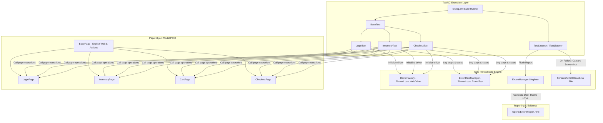

# 🚀 Enterprise Test Automation Framework (SauceDemo E-Commerce)

[](https://www.oracle.com/java/)
[](https://www.selenium.dev/)
[](https://testng.org/)
[](https://www.extentreports.com/)
[](https://maven.apache.org/)

Repositori ini merupakan kerangka kerja otomatisasi pengujian web (**Web Automation Testing Framework**) tingkat *enterprise* yang dikembangkan menggunakan **Java 21**, **Selenium WebDriver 4**, **TestNG**, dan **ExtentReports 5**. Proyek ini dibuat sebagai bagian dari **JuaraCoding SQA Bootcamp 2026 (Modul 4 Hari 18)** dengan objek pengujian aplikasi e-commerce [SauceDemo](https://www.saucedemo.com/).

Dokumen ini disusun secara terstruktur dan komprehensif agar dapat dipahami dengan mudah oleh tim pengembang/SDET maupun dianalisis dan dikembangkan lebih lanjut secara otomatis oleh **Agent AI**.

---

## 📑 Daftar Isi

- [1. Ringkasan Proyek & Spesifikasi](#1-ringkasan-proyek--spesifikasi)
- [2. Arsitektur & Pola Desain (Design Patterns)](#2-arsitektur--pola-desain-design-patterns)
- [3. Struktur Direktori Proyek (File Structure)](#3-struktur-direktori-proyek-file-structure)
- [4. Matriks Komponen & Tanggung Jawab Kelas](#4-matriks-komponen--tanggung-jawab-kelas)
- [5. Konfigurasi Suite Pengujian (testng.xml)](#5-konfigurasi-suite-pengujian-testngxml)
- [6. Cakupan Test Case & Skenario Pengujian](#6-cakupan-test-case--skenario-pengujian)
- [7. Mekanisme Pelaporan & Bukti Cacat (ExtentReports 5)](#7-mekanisme-pelaporan--bukti-cacat-extentreports-5)
- [8. Panduan Menjalankan Pengujian (Execution Guide)](#8-panduan-menjalankan-pengujian-execution-guide)
- [9. Panduan Khusus AI Agent (Context & Extension Guide)](#9-panduan-khusus-ai-agent-context--extension-guide)

---

## 1. Ringkasan Proyek & Spesifikasi

| Informasi | Spesifikasi Teknis |
| :--- | :--- |
| **Aplikasi Target (SUT)** | [SauceDemo](https://www.saucedemo.com/) (Swag Labs E-Commerce) |
| **Bahasa Pemrograman** | Java 21 (LTS) |
| **Automation Tool** | Selenium WebDriver `4.25.0` (W3C Standard, Selenium Manager auto-binaries) |
| **Test Runner & Assertions** | TestNG `7.10.2` |
| **Reporting Engine** | ExtentReports `5.1.2` (ExtentSparkReporter Dark Theme) |
| **Build & Dependency Tool** | Apache Maven Compiler `3.13.0`, Surefire Plugin `3.5.0` |
| **Utilities** | Apache Commons IO `2.16.1`, SLF4J Simple Logger `2.0.16` |
| **Model Eksekusi** | Parallel Testing (`parallel="classes"`, `thread-count="2"`) via Java `ThreadLocal` |

---

## 2. Arsitektur & Pola Desain (Design Patterns)

Framework ini menerapkan standar industri pengujian otomasi untuk menjamin prinsip **Clean Code**, **High Maintainability**, **Thread Safety**, dan **Reusability**:



### 1. Page Object Model (POM) & PageFactory
Memisahkan representasi antarmuka halaman web (Web Elements) dan logika tindakan (Actions) dari kode pengujian (Test Scripts). Setiap halaman mewarisi `BasePage` yang mengelola `WebDriverWait`, interaksi elemen yang aman, dan inisialisasi `@FindBy` melalui `PageFactory.initElements`.

### 2. Thread-Safe Factory Pattern (DriverFactory)
Mengelola instansiasi `WebDriver` berbasis parameter (`chrome`, `firefox`, `edge`). Menggunakan `ThreadLocal<WebDriver>` untuk mengisolasi setiap sesi browser pada thread-nya sendiri, memungkinkan eksekusi pengujian secara paralel tanpa tabrakan memori atau state.

### 3. Thread-Safe ExtentTest Manager
Mengisolasi pelaporan pengujian pada level thread melalui `ThreadLocal<ExtentTest>`. Setiap method pengujian yang berjalan secara bersamaan memiliki node report independen pada ExtentSparkReporter.

### 4. Observer Pattern (TestNG TestListener)
Mengimplementasikan antarmuka `ITestListener`. Siklus hidup pengujian (`onTestStart`, `onTestSuccess`, `onTestFailure`, `onTestSkipped`) dimonitor secara otomatis:
- Pembuatan node laporan otomatis dengan kategori kelas dan grup.
- Penangkapan bukti screenshot otomatis ketika pengujian gagal (**Defect Evidence**).
- Format screenshot **Base64** disematkan langsung ke dalam file HTML sehingga laporan dapat dipindahkan atau dikirim via email tanpa dependensi path lokal.

---

## 3. Struktur Direktori Proyek (File Structure)

Berikut adalah struktur lengkap seluruh direktori dan file dalam repositori ini:

```
source-day18/
│
├── pom.xml                                  # Konfigurasi Maven dependencies, compiler, dan surefire plugin
├── .vscode/
│   └── settings.json                        # Pengaturan editor VS Code untuk analisis Java
│
├── reports/                                 # Output laporan eksekusi pengujian (Auto-generated)
│   ├── ExtentReport.html                    # Dashboard interaktif ExtentReports 5.1.2 (Dark Theme)
│   └── screenshots/                         # Direktori fallback file screenshot PNG
│
├── src/
│   ├── main/
│   │   └── java/
│   │       └── com/juaracoding/framework/
│   │           │
│   │           ├── drivers/
│   │           │   └── DriverFactory.java   # Pengelola driver multi-browser & ThreadLocal isolation
│   │           │
│   │           ├── pages/                   # Lapisan Page Object Model (POM)
│   │           │   ├── BasePage.java        # Kelas induk abstrak: Explicit wait, reusable wrappers, JS executor
│   │           │   ├── LoginPage.java       # Page Object halaman Login SauceDemo
│   │           │   ├── InventoryPage.java   # Page Object katalog produk & fitur sorting
│   │           │   ├── CartPage.java        # Page Object halaman keranjang belanja
│   │           │   └── CheckoutPage.java    # Page Object alur checkout (Step 1, Step 2, Complete)
│   │           │
│   │           ├── reports/                 # Lapisan integrasi ExtentReports 5
│   │           │   ├── ExtentManager.java   # Singleton konfigurasi ExtentSparkReporter dan metadata sistem
│   │           │   └── ExtentTestManager.java # Wrapper ThreadLocal untuk logging status & markup test
│   │           │
│   │           └── utils/                   # Lapisan utilitas pembantu
│   │               ├── Constants.java       # Konstanta global (BASE_URL, default credentials, timeout)
│   │               └── ScreenshotUtil.java  # Utilitas capture screenshot (Base64 string & file PNG)
│   │
│   └── test/
│       ├── java/
│       │   └── com/juaracoding/framework/
│       │       │
│       │       ├── BaseTest.java            # Kelas induk test: Inisialisasi setUp (@BeforeMethod) & tearDown (@AfterMethod)
│       │       │
│       │       ├── listeners/
│       │       │   └── TestListener.java    # TestNG ITestListener: Logging, tag categorization, auto-screenshot
│       │       │
│       │       └── tests/                   # Kumpulan skenario pengujian (TestNG Classes)
│       │           ├── LoginTest.java       # Skenario pengujian autentikasi (Positive & Negative)
│       │           ├── InventoryTest.java   # Skenario pengujian katalog & algoritma sorting
│       │           └── CheckoutTest.java    # Skenario pengujian transaksi E2E & form validation
│       │
│       └── resources/
│           └── testng.xml                   # Konfigurasi suite TestNG, parameter runner, dan kelas eksekusi
│
└── target/                                  # Direktori hasil build Maven dan Surefire reports
```

---

## 4. Matriks Komponen & Tanggung Jawab Kelas

| Paket / Direktori | Kelas | Tanggung Jawab Utama |
| :--- | :--- | :--- |
| `com.juaracoding.framework.drivers` | `DriverFactory` | Inisialisasi `ChromeDriver`, `FirefoxDriver`, `EdgeDriver`. Mendukung opsi *headless*, optimasi browser arguments (disable password bubbles, leak detection, remote allow origins), dan manajemen lifecycle thread (`setDriver`, `getDriver`, `quitDriver`). |
| `com.juaracoding.framework.pages` | `BasePage` | Menyediakan wrapper interaksi aman berbasis explicit wait (`WebDriverWait` 15 detik): `waitForVisibility`, `waitForClickability`, `click`, `type`, `getText`, `isDisplayed`, `scrollToElement`, `getCurrentUrl`. |
| `com.juaracoding.framework.pages` | `LoginPage` | Encapsulation elemen login (`#user-name`, `#password`, `#login-button`, error message, logo) serta metode transaksi autentikasi (`loginDefault()`, `loginWithParameters()`). |
| `com.juaracoding.framework.pages` | `InventoryPage` | Encapsulation katalog produk, perhitungan jumlah item, ekstraksi list nama dan harga, interaksi dropdown sortir (`selectSortOption`), dynamic xpath untuk tombol *Add to cart* berbasis nama produk, dan badge keranjang. |
| `com.juaracoding.framework.pages` | `CartPage` | Encapsulation verifikasi item dalam keranjang belanja, pengecekan ketersediaan produk, dan navigasi tombol *Checkout* atau *Continue Shopping*. |
| `com.juaracoding.framework.pages` | `CheckoutPage` | Encapsulation 3 tahapan alur checkout: Form Informasi Pelanggan (Step 1), Overview & Total Pembayaran (Step 2), serta Konfirmasi Pesanan Selesai (Step 3). |
| `com.juaracoding.framework.reports` | `ExtentManager` | Konfigurasi singleton untuk `ExtentSparkReporter` (Theme Dark, judul dokumen, report name, timestamp format, info spesifikasi OS, Java, dan lingkungan). |
| `com.juaracoding.framework.reports` | `ExtentTestManager` | Thread-safe logging (`info`, `pass`, `fail`, `skip`, `log`) yang diarahkan langsung ke node pengujian aktif di thread bersangkutan. |
| `com.juaracoding.framework.utils` | `Constants` | Sentralisasi data statis: `BASE_URL = "https://www.saucedemo.com/"`, `USERNAME = "standard_user"`, `PASSWORD = "secret_sauce"`, `TIMEOUT = 10`. |
| `com.juaracoding.framework.utils` | `ScreenshotUtil` | Fungsi pemotretan layar saat terjadi failure: `captureBase64` (untuk embedding langsung ke HTML) dan `captureToFile` (penyimpanan file fisik). |
| `com.juaracoding.framework` | `BaseTest` | Lifecycle TestNG hooks: `@BeforeMethod` membaca parameter browser/headless dan membuka base URL; `@AfterMethod` menutup browser dan membersihkan ThreadLocal (`unload`). |
| `com.juaracoding.framework.listeners` | `TestListener` | Mengikat siklus TestNG ke ExtentReports; mencatat nama method, deskripsi, kategori class, grup tag; dan melampirkan screenshot Base64 saat `onTestFailure`. |

---

## 5. Konfigurasi Suite Pengujian (testng.xml)

Suite TestNG dikonfigurasi pada file `src/test/resources/testng.xml`:

```xml
<?xml version="1.0" encoding="UTF-8"?>
<!DOCTYPE suite SYSTEM "https://testng.org/testng-1.0.dtd">
<suite name="SauceDemo Enterprise Automation Suite" parallel="classes" thread-count="2" verbose="1">

    <listeners>
        <listener class-name="com.juaracoding.framework.listeners.TestListener" />
    </listeners>

    <parameter name="browser" value="chrome" />
    <parameter name="headless" value="false" />

    <test name="SauceDemo Regression &amp; E2E Tests">
        <classes>
            <class name="com.juaracoding.framework.tests.LoginTest" />
            <class name="com.juaracoding.framework.tests.InventoryTest" />
            <class name="com.juaracoding.framework.tests.CheckoutTest" />
        </classes>
    </test>

</suite>
```

### Parameter Kunci:
- **`parallel="classes"`**: Menginstruksikan TestNG untuk menjalankan kelas pengujian secara paralel pada thread yang berbeda.
- **`thread-count="2"`**: Mengalokasikan 2 worker thread simultan.
- **`<parameter name="browser" value="chrome" />`**: Pilihan browser default (`chrome`, `firefox`, `edge`).
- **`<parameter name="headless" value="false" />`**: Mode headless (`true` untuk CI/CD pipeline, `false` untuk visual debugging).

---

## 6. Cakupan Test Case & Skenario Pengujian

Total terdapat **9 skenario pengujian otomatis** yang terorganisir ke dalam 3 test suite:

### 1. Suite: `LoginTest` (Autentikasi Pengguna)
| # | Nama Method | Prioritas | Groups | Tipe | Deskripsi Skenario & Validasi |
| :-: | :--- | :-: | :--- | :--- | :--- |
| 1 | `testValidLogin` | 1 | `smoke`, `auth` | Positive | Memverifikasi login dengan kredensial valid `standard_user`. Memvalidasi redirect ke landing page katalog produk (`Products`). |
| 2 | `testLockedOutUser` | 2 | `negative`, `auth` | Negative | Memverifikasi penolakan akses untuk akun yang terkunci `locked_out_user`. Memvalidasi pesan error: *"Sorry, this user has been locked out"*. |
| 3 | `testInvalidPassword` | 3 | `negative`, `auth` | Negative | Memverifikasi penolakan akses saat input password salah. Memvalidasi pesan error: *"Username and password do not match"*. |

### 2. Suite: `InventoryTest` (Katalog Produk & Sorting)
| # | Nama Method | Prioritas | Groups | Tipe | Deskripsi Skenario & Validasi |
| :-: | :--- | :-: | :--- | :--- | :--- |
| 4 | `testProductListingAndCount` | 1 | `regression`, `catalog` | Functional | Memverifikasi integritas katalog menampilkan tepat 6 produk default, serta memastikan keberadaan produk *"Sauce Labs Backpack"* dan *"Sauce Labs Fleece Jacket"*. |
| 5 | `testSortingPriceLowToHigh` | 2 | `regression`, `catalog` | Functional | Menguji fungsionalitas pengurutan harga termurah ke termahal (*Price: Low to High*). Mengambil seluruh harga di UI dan membandingkannya dengan Java `Collections.sort` (Ascending). |
| 6 | `testSortingNameZToA` | 3 | `regression`, `catalog` | Functional | Menguji fungsionalitas pengurutan alfabet terbalik (*Name: Z to A*). Mengambil seluruh nama di UI dan membandingkannya dengan sorting `Comparator.reverseOrder()` (Descending). |

### 3. Suite: `CheckoutTest` (Transaksi E2E & Validasi Keranjang)
| # | Nama Method | Prioritas | Groups | Tipe | Deskripsi Skenario & Validasi |
| :-: | :--- | :-: | :--- | :--- | :--- |
| 7 | `testEndToEndCheckoutFlow` | 1 | `smoke`, `e2e` | End-to-End | Menguji siklus pembelian lengkap dari hulu ke hilir: Login -> Tambah 2 produk (*Backpack* & *Bike Light*) -> Cek Badge Keranjang (2) -> Buka Cart -> Lanjut Checkout -> Isi Data Diri (*Budi Santoso, 12345*) -> Verifikasi Ringkasan & Total Harga -> Selesaikan Pesanan (*Finish*) -> Validasi Header *"Thank you for your order!"*. |
| 8 | `testCheckoutWithEmptyInformation` | 2 | `negative`, `checkout` | Negative | Memverifikasi validasi form checkout saat field nama dikosongkan. Memvalidasi kemunculan pesan error: *"Error: First Name is required"*. |
| 9 | `testCheckoutWithEmptyCart` | 3 | `negative`, `checkout` | Negative | Menguji perilaku aplikasi ketika proses checkout diinisiasi langsung dari keranjang kosong. |

---

## 7. Mekanisme Pelaporan & Bukti Cacat (ExtentReports 5)

Laporan otomatisasi dibangun menggunakan **ExtentReports versi 5.1.2** dengan adapter **ExtentSparkReporter**:

1. **Dashboard Visual**:
   - Menampilkan metrik eksekusi (Total Tests, Passed, Failed, Skipped).
   - Diagram Pie Chart status eksekusi.
   - Durasi eksekusi per test dan total runtime.
2. **Kategorisasi & Tagging Otomatis**:
   - Setiap test otomatis dikelompokkan berdasarkan Nama Kelas (`LoginTest`, `InventoryTest`, `CheckoutTest`).
   - Setiap test dikelompokkan berdasarkan TestNG Groups (`smoke`, `regression`, `auth`, `catalog`, `checkout`, `e2e`).
3. **Defect Evidence (Automatic Embedded Screenshot)**:
   - Jika suatu assertion gagal atau terjadi runtime exception, `TestListener.onTestFailure()` memicu `ScreenshotUtil.captureBase64()`.
   - String Base64 langsung disisipkan ke dalam laporan HTML via `MediaEntityBuilder.createScreenCaptureFromBase64String()`.
   - **Keuntungan**: Laporan berformat *single standalone HTML* yang portabel dan tidak akan kehilangan gambar screenshot saat dipindahkan antar komputer atau diunggah ke server artifact CI/CD.
4. **Lokasi File Output**:
   - Laporan utama: `reports/ExtentReport.html`
   - Salinan Surefire XML & HTML: `target/surefire-reports/`

---

## 8. Panduan Menjalankan Pengujian (Execution Guide)

### Prasyarat Lingkungan (Prerequisites)
- **Java Development Kit (JDK)**: Versi 21 atau lebih baru (`java -version`).
- **Apache Maven**: Versi 3.8+ (direkomendasikan 3.9.x, cek via `mvn -version`).
- **Web Browser**: Google Chrome (default), Mozilla Firefox, atau Microsoft Edge terpasang di sistem. *(Selenium Manager 4 secara otomatis mengunduh driver binary yang sesuai, tidak perlu konfigurasi path chromedriver manual)*.

### Perintah Eksekusi via Terminal / CLI

```powershell
# 1. Jalankan seluruh suite pengujian sesuai konfigurasi testng.xml
mvn clean test

# 2. Jalankan pengujian dalam mode Headless (Cocok untuk CI/CD atau background task)
mvn clean test -Dheadless=true

# 3. Jalankan pengujian menggunakan browser lain (misal: Firefox atau Edge)
mvn clean test -Dbrowser=firefox
mvn clean test -Dbrowser=edge

# 4. Jalankan satu kelas pengujian tertentu
mvn test -Dtest=LoginTest
mvn test -Dtest=InventoryTest
mvn test -Dtest=CheckoutTest

# 5. Jalankan satu method test spesifik
mvn test -Dtest=LoginTest#testValidLogin

# 6. Jalankan pengujian berdasarkan kelompok/kategori (TestNG Groups)
mvn test -Dgroups="smoke"
mvn test -Dgroups="regression"
mvn test -Dgroups="negative"
mvn test -Dgroups="e2e"
```

### Eksekusi melalui IDE (IntelliJ IDEA / Eclipse / VS Code)
1. Buka file `src/test/resources/testng.xml`.
2. Klik kanan pada file tersebut dan pilih **Run '.../testng.xml'**.
3. Hasil eksekusi akan muncul di panel Test Runner IDE dan file laporan diperbarui di `reports/ExtentReport.html`.

---

## 9. Panduan Khusus AI Agent (Context & Extension Guide)

> [!NOTE]
> Bagian ini didesain khusus agar **Agent AI** (seperti Antigravity, Claude Code, Cursor, GitHub Copilot, dsb.) dapat memahami *mental model* dan *guidelines* proyek ini saat diminta menganalisis, memperbaiki bug, atau menambahkan fitur pengujian baru.

### 1. State Management & Threading Rules
- **Akses Driver**: JANGAN pernah membuat variabel `WebDriver driver` statis secara langsung. Selalu gunakan `DriverFactory.getDriver()` atau `getDriver()` dari kelas turunan `BaseTest`.
- **Teardown Lifecycle**: Inisialisasi dan penghapusan driver dikelola secara terpusat di `BaseTest.java` melalui `@BeforeMethod` dan `@AfterMethod`. Jangan memanggil `driver.quit()` di dalam test method.
- **Reporting Logs**: Gunakan `ExtentTestManager.info("...")`, `ExtentTestManager.pass("...")`, atau `ExtentTestManager.fail("...")` untuk menambahkan catatan audit langkah uji ke dalam HTML report.

### 2. Standar Pembuatan Page Object Baru
Jika diminta menambahkan halaman baru (misal: `ProductDetailPage.java`):
1. Letakkan di package `com.juaracoding.framework.pages`.
2. Buat kelas tersebut mewarisi (`extends`) `BasePage`.
3. Definisikan constructor yang menerima `WebDriver` dan memanggil `super(driver)`.
4. Deklarasikan locators menggunakan anotasi `@FindBy(id = "...")`, `@FindBy(css = "...")`, atau `@FindBy(xpath = "...")` dengan hak akses `private`.
5. Bungkus aksi elemen menggunakan metode yang disediakan di `BasePage` (`click`, `type`, `getText`, `isDisplayed`, dsb.) untuk memastikan *explicit wait* selalu diterapkan.

**Contoh Template:**
```java
package com.juaracoding.framework.pages;

import org.openqa.selenium.WebDriver;
import org.openqa.selenium.WebElement;
import org.openqa.selenium.support.FindBy;

public class ProductDetailPage extends BasePage {

    @FindBy(className = "inventory_details_name")
    private WebElement productName;

    @FindBy(id = "back-to-products")
    private WebElement backButton;

    public ProductDetailPage(WebDriver driver) {
        super(driver);
    }

    public String getProductName() {
        return getText(productName);
    }

    public void clickBack() {
        click(backButton);
    }
}
```

### 3. Standar Pembuatan Test Case Baru
Jika diminta menambahkan skenario pengujian baru:
1. Letakkan di package `com.juaracoding.framework.tests`.
2. Pastikan kelas test mewarisi (`extends`) `BaseTest`.
3. Beri anotasi `@Test` dengan atribut `priority`, `description`, dan `groups` yang relevan.
4. Gunakan instansiasi Page Object dengan mengoperasikan `getDriver()`.
5. Lakukan assertion menggunakan TestNG `Assert` (`Assert.assertEquals`, `Assert.assertTrue`, dsb.).
6. Jangan lupa mendaftarkan kelas test baru ke dalam `src/test/resources/testng.xml` di dalam tag `<classes>`.

**Contoh Template:**
```java
package com.juaracoding.framework.tests;

import com.juaracoding.framework.BaseTest;
import com.juaracoding.framework.pages.LoginPage;
import com.juaracoding.framework.reports.ExtentTestManager;
import org.testng.Assert;
import org.testng.annotations.Test;

public class SampleTest extends BaseTest {

    @Test(priority = 1, description = "Verifikasi deskripsi skenario", groups = {"regression"})
    public void testContoh() {
        LoginPage loginPage = new LoginPage(getDriver());
        ExtentTestManager.info("Langkah 1: Melakukan login");
        loginPage.loginDefault();

        ExtentTestManager.info("Langkah 2: Melakukan validasi");
        Assert.assertTrue(getDriver().getCurrentUrl().contains("inventory"), "URL harus mengarah ke inventori");
        ExtentTestManager.pass("Validasi URL berhasil");
    }
}
```

---

*Dikembangkan untuk JuaraCoding Quality Assurance & SDET Learning Journey 2026.*

